# AI-Native Storage Engine 设计方案（总览与架构）

> 项目代号：**AINS**（AI-Native Intelligent Storage）
>
> 核心设计思想：让 AI 成为数据访问和数据操作的主要入口，让存储引擎成为直接面向 AI 工作负载和底层硬件的执行系统。
>
> 状态：设计阶段 · 对应实现蓝图见 [docs/architecture](../architecture/01-overview.md) 与 [ADR](../adr/)

项目代号：AINS（AI-Native Intelligent Storage）

核心设计思想：让 AI 成为数据访问和数据操作的主要入口，让存储引擎成为直接面向 AI 工作负载和底层硬件的执行系统。

这不是在传统数据库上增加一个 AI 插件，也不是简单地把 SQL 替换成自然语言，而是重新设计一套数据库体系：

- 不再以 SQL 作为核心查询语言。
- 不再以关系表、行、列作为唯一的数据组织方式。
- 不再以 CPU 执行传统 Volcano 算子作为唯一执行模型。
- 不再让通用 Buffer Manager 和传统文件系统成为硬件访问的必经抽象。
- 根据 AI 的理解、推理、检索、训练、推理服务等工作负载设计数据组织和执行路径。
- 让存储引擎感知 CPU、内存、NUMA、NVMe SSD、GPU、RDMA 等硬件资源。

不过，有一个非常重要的设计原则：

AI 替代 SQL，不意味着让 LLM 直接操作磁盘。

AI 负责理解用户意图、数据语义、任务规划和执行策略；存储引擎负责确定性执行、事务一致性、并发控制、持久化和故障恢复。

也就是说，应该构建：

AI 负责决策，存储引擎负责执行，硬件负责加速。

## 一、重新定义数据库：从 SQL Database 到 AI Storage System

### 1.1 传统数据库的设计模型

传统数据库的架构主要围绕关系模型设计：

典型执行流程：

```
用户
 │
 ▼
SQL
 │
 ▼
Parser
 │
 ▼
Analyzer
 │
 ▼
Optimizer
 │
 ▼
Executor
 │
 ▼
Buffer Manager
 │
 ▼
Storage Manager
 │
 ▼
Filesystem
 │
 ▼
Disk
```

传统数据库的核心抽象是：

| 层次   | 核心抽象                      |
| ---- | ------------------------- |
| 用户接口 | SQL                       |
| 数据模型 | Database / Schema / Table |
| 数据组织 | Row / Column / Page       |
| 查询优化 | Relational Algebra        |
| 执行模型 | Operator / Tuple          |
| 内存管理 | Buffer Pool               |
| 存储管理 | Heap / B-tree / WAL       |
| 硬件访问 | Filesystem / Block Device |

这种架构有一个重要特点：

数据库首先抽象数据，然后通过统一执行模型访问数据，最后由存储层访问硬件。

这套体系非常适合 OLTP、OLAP 等传统工作负载。

但是，AI 工作负载带来了不同的数据访问需求。

### 1.2 AI 工作负载与传统数据库的差异

AI 系统的数据访问不只是传统的增删改查。

| AI 工作负载     | 主要数据需求            | 传统数据库的局限           |
| ----------- | ----------------- | ------------------ |
| RAG         | 语义检索、上下文关联        | 需要额外的向量索引和检索系统     |
| Agent       | 多步骤数据探索、工具调用      | SQL 不直接表达复杂任务意图    |
| LLM 推理      | 模型权重、KV Cache、上下文 | 传统行列存储不是最佳组织方式     |
| AI 训练       | 大规模 Tensor、批量读取   | 传统事务执行开销较大         |
| 多模态 AI      | 图片、音频、视频、文本       | 数据类型和存储组织复杂        |
| Graph RAG   | 实体、关系、路径关联        | 需要额外图计算系统          |
| AI Memory   | 长期记忆、短期记忆、经验      | 传统表结构不适合直接表达记忆生命周期 |
| AI Agent 协作 | 任务状态、共享上下文        | 需要新的状态管理和并发模型      |

因此，AI-Native Storage 不应该仅仅是一个支持 Vector 的数据库。

它应该是一个能够直接理解和管理 AI 数据生命周期的存储系统。

### 1.3 新的数据库设计目标

我们将整个系统重新定义为五个核心目标：

1. AI-Native Interface：以 AI 意图代替 SQL，提供面向任务的数据访问接口。
2. AI-Native Data Model：以 Context、Memory、Embedding、Tensor、Graph、Object 等为核心数据对象。
3. AI-Native Execution：以任务图和数据流为核心组织执行。
4. Hardware-Native Storage：存储引擎直接感知硬件资源，减少不必要的软件抽象。
5. AI-Native Optimization：利用 AI 工作负载特征和历史运行信息优化数据布局、缓存、索引和执行计划。

## 二、整体系统架构

### 2.1 总体架构

建议将系统划分为六个主要层次：

1. AI Interface Layer
2. AI Intelligence Layer
3. Semantic Data Layer
4. Execution Engine Layer
5. Hardware-Aware Storage Layer
6. Hardware Abstraction Layer

架构关系如下：

```mermaid
flowchart TB
    subgraph L1["1 · AI Interface Layer"]
        L1A["NL API / Intent API / Object API"]
        L1B["SDK · Workflow API · Agent Tool Interface"]
    end
    subgraph L2["2 · AI Intelligence Layer"]
        L2A["Semantic Understanding"]
        L2B["Intent Planner"]
        L2C["Reasoning Engine"]
        L2D["Policy & Permission"]
        L2E["Workload Learning"]
    end
    subgraph L3["3 · Semantic Data Layer"]
        L3A["Object Store"]
        L3B["Context Store"]
        L3C["Memory Store"]
        L3D["Vector Store"]
        L3E["Tensor Store"]
        L3F["Graph Store"]
        L3G["Metadata & Schema"]
    end
    subgraph L4["4 · Execution Engine Layer"]
        L4A["Task DAG Scheduler"]
        L4B["Retrieval Engine"]
        L4C["Streaming Engine"]
        L4D["Batch Engine"]
        L4E["Transaction Manager"]
        L4F["Cache Manager"]
    end
    subgraph L5["5 · Hardware-Aware Storage Layer"]
        L5A["Adaptive Data Layout"]
        L5B["Multi-Modal Index"]
        L5C["Direct I/O Engine"]
        L5D["WAL & Recovery"]
        L5E["Compaction & GC"]
    end
    subgraph L6["6 · Hardware Abstraction Layer"]
        L6A["CPU / NUMA"]
        L6B["DRAM / CXL"]
        L6C["GPU / HBM"]
        L6D["NVMe / SSD"]
        L6E["RDMA / Network"]
    end
    USER(["AI Agent / User / Application"])
    USER --> L1
    L1 --> L2 --> L3 --> L4 --> L5 --> L6
```

这里有一个值得强调的设计：

AI Intelligence Layer 不应该直接操作物理存储。

它生成的是可验证的执行计划，而不是任意硬件指令。

例如用户提出：

> 找出过去一个月与 PostgreSQL 并行解码性能问题有关的技术资料，按照问题类型分类，提取核心解决方案，并关联相关源码函数。

AI 不应该将这句话翻译成一条复杂 SQL。

它应该形成一个任务 DAG：

```
任务：技术资料分析
       │
       ▼
  数据范围确定
       │
       ▼
  语义检索
       │
       ▼
  关键词过滤
       │
       ▼
  相关文档读取
       │
       ▼
  函数实体抽取
       │
       ▼
  关系关联
       │
       ▼
  内容聚合
       │
       ▼
  结果生成
```

执行引擎根据 DAG 确定哪些步骤可以并行、哪些步骤需要访问 GPU、哪些数据需要从 NVMe 读取。

### 2.2 核心模块及职责

| 模块                     | 主要职责              | 是否使用 AI |
| ---------------------- | ----------------- | ------- |
| AI Interface           | 接收用户请求和 Agent 请求  | 否       |
| Semantic Understanding | 理解用户意图和数据语义       | 是       |
| Intent Planner         | 生成任务执行计划          | 是 + 规则  |
| Policy Engine          | 权限、约束、操作校验        | 否       |
| Data Model             | 管理不同类型的数据对象       | 否       |
| Task Scheduler         | 调度任务和数据流          | 规则 + 学习 |
| Retrieval Engine       | 向量、全文、图、混合检索      | 否       |
| Transaction Manager    | 事务一致性             | 否       |
| Storage Manager        | 数据布局、索引、持久化       | 否       |
| Hardware Manager       | CPU、GPU、NVMe 资源管理 | 否       |
| Workload Learner       | 分析历史工作负载并提出优化建议   | 是       |

这里需要明确：AI 不应该参与每一次底层读写的决策。

如果每次读取一个数据块都需要调用 LLM，那么系统的延迟和成本将不可接受。

AI 更适合参与：

- 意图理解。
- 复杂任务规划。
- 数据语义关联。
- 数据布局优化建议。
- 工作负载模式识别。

而普通数据读取、索引访问、事务管理和 I/O 调度必须由确定性内核完成。

## 三、重新设计数据模型：不再以 Table 为中心

这是整个系统最重要的设计之一。

如果只是把 SQL Parser 替换成 LLM，底层仍然使用传统 Table、Tuple、Page、B-tree，那么本质上还是传统数据库。

我们需要重新设计数据的组织形式。

### 3.1 从关系数据模型转向 AI 数据对象模型

建议引入七种核心数据对象。

1. Vector Object

Embedding、语义特征、向量索引、相似度关系。

2. Graph Object

实体、关系、路径、依赖关系和知识网络。

3. Tensor Object

模型权重、张量、矩阵、训练数据、推理中间结果。

4. Document Object

文档、文本、代码、结构化和半结构化内容。

5. Memory Object

短期记忆、长期记忆、经验、事件和上下文。

6. Media Object

图片、视频、音频、3D 数据及多模态内容。

7. Event Object

事件、操作记录、任务状态、时间序列和执行历史。

这七种数据对象不需要分别建设七个独立数据库。

它们应该统一纳入一个存储引擎，由统一的对象管理、事务、索引、缓存和持久化机制管理。

### 3.2 统一的数据对象结构

可以设计统一的 Object Header：

```
typedef struct AIObject
{
    ObjectId    id;

    ObjectType  type;

    ObjectId    namespace_id;

    uint64      version;

    uint64      create_timestamp;
    uint64      update_timestamp;

    uint32      flags;

    StorageRef  storage_ref;

    IndexRef    index_ref;

    ContextRef  context_ref;

    SecurityRef security_ref;

} AIObject;
```

不同数据类型拥有各自的 Payload：

```
AIObject
    |
    +-- VectorPayload
    |
    +-- GraphPayload
    |
    +-- TensorPayload
    |
    +-- DocumentPayload
    |
    +-- MemoryPayload
    |
    +-- MediaPayload
    |
    +-- EventPayload
```

其中：

- Object Header 统一管理对象身份、版本和生命周期。
- Payload 负责数据类型专属的存储格式。
- StorageRef 定位物理存储位置。
- IndexRef 关联一个或多个索引。
- ContextRef 关联上下文和语义关系。
- SecurityRef 管理数据访问权限。

这使得同一个对象可以同时参与不同类型的检索。

例如一个 PostgreSQL 源码文件：

```
Object: postgres/reorderbuffer.c

    Document:
        源码文件内容

    Vector:
        源码语义 Embedding

    Graph:
        ReorderBufferProcessTXN
            |
            +-- ReorderBufferQueueChange
            +-- ReorderBufferApplyChange
            +-- ReorderBufferCommit

    Memory:
        历史分析结论

    Event:
        文件修改历史
```

传统数据库可能需要多个表和多个索引才能表达这些信息。

AI-Native Storage 将它们作为同一个逻辑对象的不同数据视图。

### 3.3 数据逻辑组织与物理组织分离

逻辑对象不应该直接绑定某个物理 Page。

例如：

```
Logical Object
      |
      ▼
Object Metadata
      |
      ▼
Logical Extent
      |
      ▼
Physical Extent
      |
      +-- DRAM
      +-- CXL Memory
      +-- GPU HBM
      +-- NVMe SSD
      +-- HDD
```

需要引入两个核心概念：

- Logical Extent：逻辑数据范围。
- Physical Extent：实际硬件存储范围。

这样就可以在不改变 AI 对象身份的情况下，调整底层数据布局。

例如：

- 高频访问的 Embedding 放入 DRAM。
- 模型推理热点 Tensor 放入 GPU HBM。
- 普通文档放入 NVMe。
- 冷数据放入 HDD。
- 需要 GPU 批量读取的数据采用适合 GPU 的连续布局。

## 四、AI 不再生成 SQL，而是生成 Intent DAG

### 4.1 为什么不能简单地用自然语言直接访问数据

假设用户说：

> 找出最近三个月访问频率最高的 PostgreSQL 源码函数，并分析它们之间的调用关系。

如果采用传统模式：

```
Natural Language
       |
       ▼
      LLM
       |
       ▼
      SQL
       |
       ▼
   SQL Engine
```

这实际上还是 NL2SQL。

它存在几个问题：

1. 用户意图与数据库物理结构耦合。
2. LLM 需要知道数据库 Schema。
3. 复杂操作需要拼接大量 SQL。
4. SQL 很难直接表达跨模态、跨对象的 AI 任务。
5. 查询优化仍然受传统关系代数限制。

因此建议使用新的中间表示：

Intent Intermediate Representation（IIR）

它是 AI 与存储引擎之间的核心协议。

### 4.2 Intent DAG 设计

AI 将自然语言转化为一个有向无环任务图。


例如：

用户请求：

```
查询过去30天最常被访问的100个函数，
分析它们的调用关系，
并生成一个依赖关系图。
```

生成的 Intent IR 可以是：

```
{
  "intent": "analyze_function_access",
  "scope": {
    "object_type": "document",
    "domain": "postgresql_source"
  },
  "operations": [
    {
      "op": "filter",
      "field": "access_timestamp",
      "range": "last_30_days"
    },
    {
      "op": "aggregate",
      "field": "function_id",
      "metric": "access_count"
    },
    {
      "op": "topk",
      "k": 100
    },
    {
      "op": "graph_expand",
      "relation": "calls"
    },
    {
      "op": "visualize",
      "format": "dependency_graph"
    }
  ]
}
```

注意：这里的 JSON 仅用于说明中间表示的形态，不是最终用户必须掌握的查询语言。

用户不需要编写它。

AI 负责生成，存储引擎负责验证和执行。

### 4.3 Intent IR 的核心操作集合

建议第一版定义以下操作原语：

| 操作类别 | 操作         | 含义        |
| ---- | ---------- | --------- |
| 定位   | LOCATE     | 定位数据对象    |
| 检索   | RETRIEVE   | 检索相关对象    |
| 过滤   | FILTER     | 条件过滤      |
| 相似度  | SIMILARITY | 向量相似度检索   |
| 关联   | RELATE     | 查找对象关系    |
| 遍历   | TRAVERSE   | 图关系遍历     |
| 聚合   | AGGREGATE  | 统计、归纳     |
| 排序   | RANK       | 排序和评分     |
| 读取   | READ       | 读取对象内容    |
| 写入   | WRITE      | 创建或更新对象   |
| 记忆   | REMEMBER   | 保存记忆      |
| 遗忘   | FORGET     | 过期或删除记忆   |
| 推理   | INFER      | 执行受控的模型推理 |
| 变换   | TRANSFORM  | 转换数据格式    |
| 流处理  | STREAM     | 持续处理数据流   |

这些操作组成一个小型的、稳定的执行指令集。

它的地位类似于传统数据库中的执行计划和算子体系，但不需要直接暴露给用户。

### 4.4 Intent DAG 执行模型

生成 DAG 后，由执行引擎进行任务拆分。

例如：

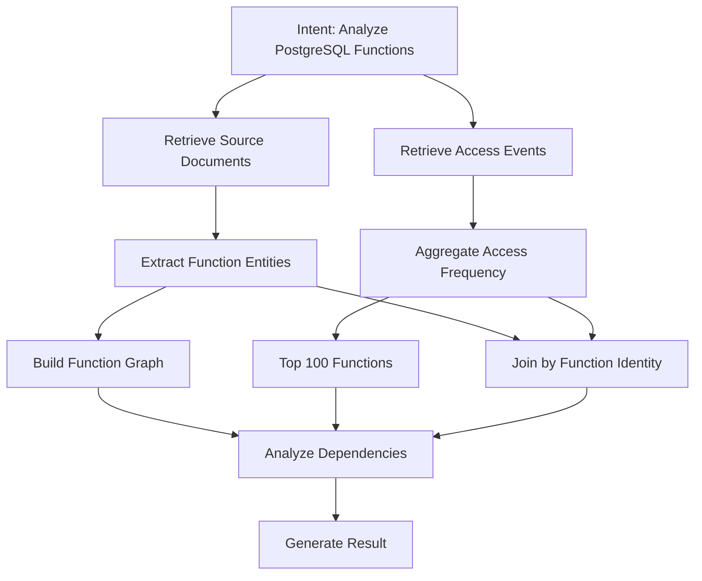

其中 B 和 C 可以并行执行。

D 和 E 也可以并行执行。

但是 H 必须等待两边结果。

这就形成了任务级并行执行模型。

相比传统数据库的 Tuple-at-a-time 执行，AI-Native Storage 更适合使用：

- Object-at-a-time。
- Batch-at-a-time。
- Tensor-at-a-time。
- Stream-at-a-time。
- Task-at-a-time。

不同数据类型使用不同的执行粒度。

## 五、存储引擎设计：直接面向硬件

这是与传统数据库区别最大的部分。

### 5.1 传统存储引擎的问题

传统 PostgreSQL 类数据库通常采用：

```
SQL Executor
     |
     ▼
Buffer Manager
     |
     ▼
Shared Buffer
     |
     ▼
Storage Manager
     |
     ▼
VFS
     |
     ▼
Block Device
```

Buffer Manager 通过 Page 管理磁盘数据。

这种模型对于传统 OLTP 很有效，但对于 AI 工作负载可能产生额外开销：

- 大量随机小块访问。
- 多次内存复制。
- CPU 与 GPU 之间的数据搬运。
- 数据读取粒度与 Tensor、Batch 不匹配。
- 不同数据类型争用同一套缓存。
- 通用 Page 组织方式无法充分利用硬件特征。

我们需要重新思考存储层。

### 5.2 新的硬件感知存储架构

建议采用：

Hardware-Aware Storage Engine（HASE）

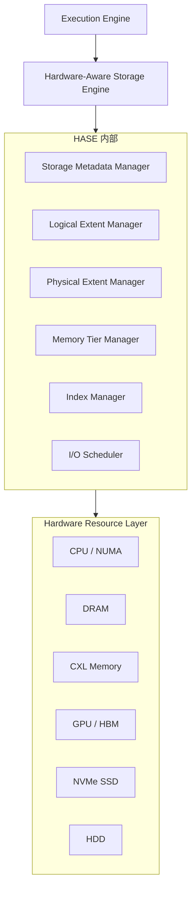

这里不再把硬件统一抽象成文件。

而是把硬件看成具有不同访问特性的资源池。

### 5.3 硬件资源模型

每种硬件有不同的特点。

| 硬件         | 优势         | 主要用途          |
| ---------- | ---------- | ------------- |
| CPU Cache  | 极低访问延迟     | 热点元数据         |
| DRAM       | 低延迟、高带宽    | 热点对象、索引       |
| CXL Memory | 可扩展内存容量    | 大规模缓存和共享数据    |
| GPU HBM    | 极高内存带宽     | Tensor、向量批量计算 |
| NVMe SSD   | 高吞吐、低延迟持久化 | 热数据和主要持久化数据   |
| HDD        | 容量大、成本低    | 冷数据、归档        |

系统需要维护硬件资源描述：

```
typedef struct HardwareResource
{
    ResourceId id;

    ResourceType type;

    uint64 capacity;

    uint64 bandwidth;

    uint64 latency;

    uint32 numa_node;

    uint32 device_id;

    ResourceStatus status;

} HardwareResource;
```

这里的 bandwidth、latency 不应该仅仅是静态配置值。

运行时应该通过硬件探测和实际 I/O 测量持续更新。

### 5.4 数据直接面向硬件的关键技术

建议把以下技术作为底层设计基础：

| 技术                    | 作用                   | 使用位置           |
| --------------------- | -------------------- | -------------- |
| io_uring              | 异步 I/O、批量提交和完成       | Linux NVMe I/O |
| SPDK                  | 用户态 NVMe 驱动和轮询式 I/O  | 高性能 NVMe 路径    |
| DPDK                  | 用户态网络数据路径            | 高性能数据传输        |
| RDMA                  | 低开销远程内存访问            | 分布式存储          |
| CUDA / HIP            | GPU 计算与数据管理          | 向量、Tensor      |
| GPUDirect Storage     | 减少 GPU 数据传输中的 CPU 中转 | GPU 直接读取存储数据   |
| NUMA-aware allocation | 减少跨 NUMA 内存访问        | 内存管理           |
| Huge Pages            | 降低页表和 TLB 开销         | 大块内存           |
| NVMe ZNS              | 顺序写入、减少设备内部写放大       | 特定日志和追加型数据布局   |

这里有一个实现上的重要选择：

第一版建议以 `io_uring + NUMA-aware DRAM + NVMe` 为基础。

SPDK、GPUDirect Storage、CXL 和 RDMA 作为后续可插拔硬件后端。

不要在第一版就同时实现所有硬件驱动。

### 5.5 内存管理：从 Buffer Pool 转向 Memory Tier Manager

传统 Buffer Pool 管理的是 Page。

新系统应该管理不同类型的内存对象。

```
Memory Tier Manager
       |
       +-- CPU Cache
       |
       +-- DRAM Pool
       |      |
       |      +-- Object Cache
       |      +-- Index Cache
       |      +-- Metadata Cache
       |
       +-- CXL Pool
       |
       +-- GPU HBM Pool
       |
       +-- NVMe Cache
```

核心变化：

传统系统：

```
Page -> Buffer -> Disk
```

新系统：

```
AI Object
    |
    +-- Metadata -> DRAM
    |
    +-- Embedding -> DRAM / GPU HBM
    |
    +-- Tensor -> GPU HBM / NVMe
    |
    +-- Document -> DRAM / NVMe
    |
    +-- Cold Data -> HDD
```

这里建议建立独立的 Cache Domain。

例如：

- Metadata Cache：保存对象元信息。
- Vector Cache：保存高频 Embedding。
- Tensor Cache：保存热点 Tensor。
- Context Cache：保存 AI 上下文。
- Index Cache：保存索引节点。

这样可以避免不同工作负载之间发生严重的缓存污染。

### 5.6 数据布局：从 Page 转向 Extent + Object

建议设计三层数据布局：

```
Object
  |
  ▼
Logical Extent
  |
  ▼
Physical Extent
  |
  ▼
Hardware Block
```

示例：

```
Document Object
    |
    +-- Metadata Extent
    |
    +-- Content Extent
    |
    +-- Embedding Extent
    |
    +-- Index Extent
```

不同数据类型使用不同物理布局：

| 类型              | 推荐布局            | 原因               |
| --------------- | --------------- | ---------------- |
| Vector          | 连续向量块、分区        | 适合 SIMD/GPU 批量计算 |
| Tensor          | 多维连续或分块布局       | 适合 GPU 访问        |
| Document        | Blob + Metadata | 适合变长内容           |
| Graph           | 邻接表 + 边分区       | 适合图遍历            |
| Memory          | 时间分区 + 语义分区     | 适合记忆检索和过期        |
| Event           | 追加写日志           | 适合顺序写入           |
| Object Metadata | 紧凑元数据块          | 适合快速定位           |

需要特别注意：不是所有数据都适合绕过操作系统 Page Cache，也不是所有数据都适合直接使用 SPDK。

应当根据访问模式决定 I/O 路径。

## 六、索引系统：从单一 B-tree 到多模态索引

AI-Native Storage 不应该只有一个通用索引。

建议使用统一索引管理器，管理不同数据类型的专用索引。

### 6.1 索引架构

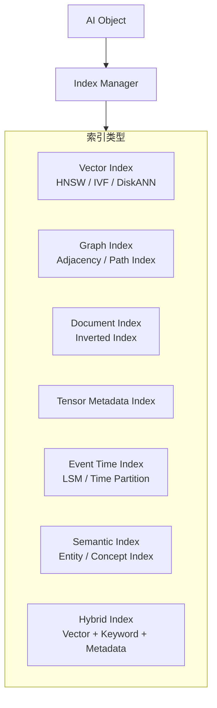

### 6.2 向量索引

向量索引主要解决：

- Embedding 相似度检索。
- Top-K 搜索。
- 高维空间近似最近邻。
- 大规模向量批量搜索。

可以支持：

- HNSW。
- IVF。
- DiskANN。
- GPU 加速的向量搜索。

具体选择取决于数据规模、更新频率、召回率和延迟要求。

### 6.3 图索引

图索引管理：

```
Node
  |
  +-- Edge
  |
  +-- Relation
  |
  +-- Neighbor
  |
  +-- Path
```

例如 PostgreSQL 源码：

```
ReorderBufferProcessTXN
       |
       +-- calls --> ReorderBufferApplyChange
       |
       +-- calls --> ReorderBufferCommit
       |
       +-- calls --> ReorderBufferBuildTupleCidHash
```

可以直接进行函数调用关系检索，而不是先检索文本再由 LLM 自行拼接关系。

### 6.4 混合索引

实际 AI 检索通常不是纯向量检索。

例如：

> 搜索 PostgreSQL 18 中负责事务重组，并且涉及快照管理的函数。

可能需要组合：

```
语义检索
    +
关键词检索
    +
函数实体检索
    +
版本过滤
    +
调用图关系
```

建议设计统一的 Hybrid Retrieval Engine：

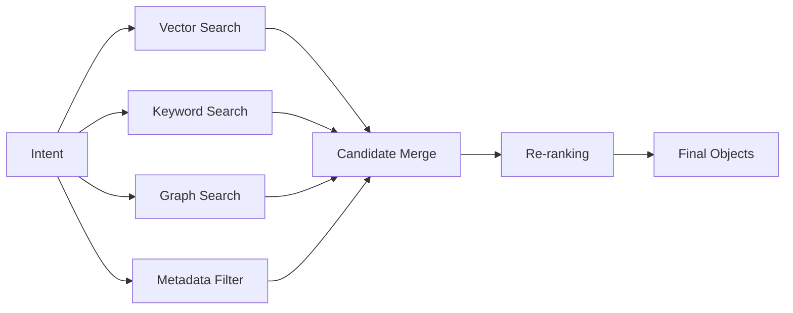

这里的 Re-ranking 可以选择规则算法、机器学习模型或外部 LLM，但基础召回不依赖 LLM。

## 七、执行引擎：从 SQL Executor 到 AI Task Runtime

传统数据库的执行器以算子为核心。

AI-Native Storage 应该以任务为核心。

### 7.1 执行器总体设计

建议包含五个核心组件：

| 组件                 | 作用                    |
| ------------------ | --------------------- |
| Intent Compiler    | 将 Intent IR 转换为执行 DAG |
| DAG Scheduler      | 管理任务依赖和调度             |
| Task Executor      | 执行检索、读取、计算等任务         |
| Resource Scheduler | 分配 CPU、GPU、内存和 I/O    |
| Result Assembler   | 汇总任务结果并生成数据输出         |

整体流程：

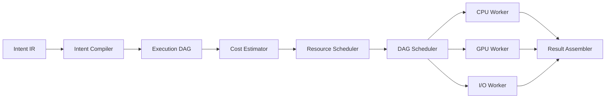

### 7.2 Worker 模型

建议把 Worker 分为四类：

1. CPU Worker

负责：

- 元数据访问。
- 对象定位。
- 复杂控制逻辑。
- 图关系遍历。
- 普通数据处理。

2. GPU Worker

负责：

- 向量相似度计算。
- Tensor 运算。
- Embedding 批处理。
- GPU 重排序。
- AI 模型推理（如果系统集成模型运行时）。

3. I/O Worker

负责：

- NVMe 异步读取。
- 批量写入。
- 数据预取。
- 磁盘数据整理。
- 持久化操作。

4. Maintenance Worker

负责：

- 索引构建。
- 索引更新。
- Compaction。
- Garbage Collection。
- 数据分层迁移。

这样可以避免 CPU、GPU 和 I/O 工作负载混杂在同一个执行线程池中。

### 7.3 执行粒度

不同任务应该选择不同执行粒度。

| 执行粒度   | 适用场景          |
| ------ | ------------- |
| Object | 对象读取、对象更新     |
| Batch  | 向量检索、文档批处理    |
| Tensor | GPU 计算        |
| Stream | 事件处理、实时数据     |
| Task   | 多步骤 Agent 工作流 |

一个重要设计是：执行引擎必须支持流水线，而不是所有任务完成后再进入下一阶段。

例如：

```
NVMe Read
     |
     ▼
Object Decode
     |
     ▼
Embedding Load
     |
     ▼
GPU Similarity
     |
     ▼
Top-K Selection
     |
     ▼
Object Retrieval
```

可以在前一批对象执行 GPU 计算时，同时读取下一批对象。

这样才能充分利用 NVMe、CPU 和 GPU 的并行能力。

### 7.4 Cost-Based + AI-Assisted Optimizer

不建议让 LLM 完全负责执行计划优化。

建议采用双层优化器：

- 确定性优化器：负责成本、资源、数据依赖和执行正确性。
- AI 辅助优化器：负责识别复杂意图、历史工作负载模式和优化机会。

成本模型可以考虑：

$$ Cost = C_{IO}+C_{CPU}+C_{GPU}+C_{Memory}+C_{Network}+C_{Sync} $$

例如：

```
Plan A:
NVMe -> CPU -> CPU Similarity

Plan B:
NVMe -> DRAM -> GPU Similarity

Plan C:
DRAM Vector Cache -> GPU Similarity
```

优化器需要综合考虑：

- 数据是否已经在 DRAM。
- GPU 是否空闲。
- NVMe 的并发队列深度。
- 数据批量大小。
- GPU 数据搬运成本。
- 任务依赖关系。
- 结果精度和召回率要求。

最终选择预计总成本最低的方案。

## 八、事务系统：不能因为面向 AI 就放弃 ACID

这是整个架构必须认真处理的问题。

AI 的任务执行具有长时间运行、多步骤、异步和可能调用外部模型的特点。

如果直接把整个 Agent 任务放进一个数据库事务，会导致事务持续时间过长、锁占用和版本保留压力。

因此建议设计双层事务体系。

### 8.1 两种事务

| 事务类型                    | 作用            | 生命周期 |
| ----------------------- | ------------- | ---- |
| Storage Transaction     | 保证底层数据修改一致性   | 短事务  |
| AI Workflow Transaction | 管理多步骤任务的状态和结果 | 长事务  |

Storage Transaction 负责：

- 对象创建、修改和删除。
- 对象版本控制。
- 并发冲突检测。
- WAL。
- 崩溃恢复。
- 持久化。

AI Workflow Transaction 负责：

- 任务状态。
- 步骤依赖。
- 中间结果。
- 失败重试。
- Checkpoint。
- 补偿操作。

两者不能混为一谈。

### 8.2 存储事务模型

建议第一版采用：

MVCC + WAL + Object Versioning

数据对象更新时不直接覆盖原始版本。

例如：

```
Object 100
    |
    +-- Version 1
    |
    +-- Version 2
    |
    +-- Version 3
```

事务读取时获得一致的快照。

更新时创建新版本，并通过提交记录使新版本对后续事务可见。

逻辑上可以定义：

```
typedef struct StorageTxn
{
    TransactionId xid;

    Snapshot snapshot;

    CommitSequence commit_seq;

    TransactionState state;

    WriteSet *write_set;

    ReadSet *read_set;

} StorageTxn;
```

注意这里的 CommitSequence 是设计层面的提交序列概念，不代表必须使用全局递增 CSN 实现。具体实现还需要考虑并发提交、可见性和恢复。

### 8.3 AI Workflow Transaction

例如一个 Agent 执行：

```
1. 读取资料
2. 提取知识
3. 建立实体关系
4. 生成 Embedding
5. 保存长期记忆
```

不应该要求五个步骤始终处于一个数据库事务中。

可以使用：

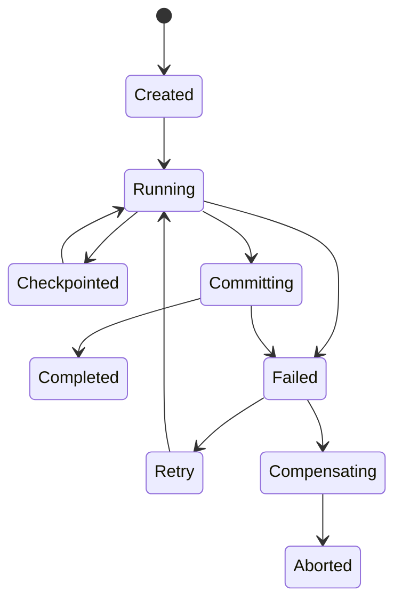

每个步骤完成后记录 Checkpoint。

这样即使 Agent 执行到第四步时发生故障，也可以从最近一次成功的 Checkpoint 恢复。

### 8.4 并发控制

AI 场景中存在大量不同类型的并发：

- 多个 Agent 同时更新同一 Memory。
- 多个任务同时更新相同 Embedding。
- GPU 任务读取正在更新的 Tensor。
- 一个 Agent 修改知识图，另一个 Agent 正在遍历知识图。

建议第一版采用：

| 数据类型     | 推荐并发策略              |
| -------- | ------------------- |
| Metadata | MVCC                |
| Document | MVCC + 乐观并发控制       |
| Vector   | 不可变索引段 + 增量更新       |
| Graph    | MVCC + 关系版本         |
| Tensor   | 不可变版本 + 引用切换        |
| Event    | Append-only         |
| Memory   | MVCC + TTL + 版本冲突检测 |

这里有一个重要原则：

数据更新与索引更新必须有明确的一致性边界。

不能出现对象已经提交，但对应索引永久丢失的情况。

可以将索引维护设计为可恢复的增量任务，并通过版本号或 LSN 水位保证查询可见性。

## 九、持久化和恢复体系

AI-Native Storage 仍然需要一个可靠的持久化体系。

不能把 DRAM 或 GPU HBM 当作持久化数据的最终存储位置。

### 9.1 WAL 设计

建议设计统一的 WAL 机制，但不再简单地以 Heap Page 变化作为唯一记录形式。

主要记录类型：

```
WAL
 |
 +-- OBJECT_CREATE
 |
 +-- OBJECT_UPDATE
 |
 +-- OBJECT_DELETE
 |
 +-- OBJECT_VERSION
 |
 +-- EXTENT_ALLOCATE
 |
 +-- EXTENT_FREE
 |
 +-- INDEX_UPDATE
 |
 +-- GRAPH_EDGE_UPDATE
 |
 +-- TENSOR_METADATA_UPDATE
 |
 +-- TRANSACTION_COMMIT
 |
 +-- TRANSACTION_ABORT
 |
 +-- CHECKPOINT
```

对于大规模 Tensor、Media 等数据，不应该把完整数据内容都写进 WAL。

建议：

```
Transaction
    |
    +-- WAL Metadata
    |
    +-- Data Extent Write
    |
    +-- Commit Record
```

通过 Write-Ahead Logging 和提交协议保证恢复时能够判断对象版本是否有效。

### 9.2 恢复流程

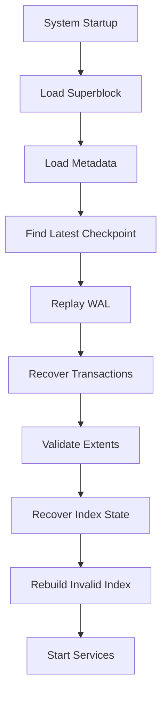

特别需要注意：

向量索引、图索引等可以支持重建，但对象元数据、版本关系、事务提交记录不能依赖索引重建来恢复。

索引应该是可恢复的派生结构，核心数据和事务状态才是恢复依据。

## 十、AI-Native Memory：一个值得独立设计的子系统

我认为 AI Memory 应该是这套系统的核心能力之一，而不是简单地作为 Vector Store 的一个应用。

因为 Agent 的长期记忆与短期上下文具有明显不同的生命周期。

### 10.1 记忆数据模型

建议分成五类：

| 记忆类型               | 含义        | 生命周期 |
| ------------------ | --------- | ---- |
| Working Memory     | 当前任务上下文   | 任务级  |
| Episodic Memory    | 历史事件和经历   | 长期   |
| Semantic Memory    | 提炼后的知识    | 长期   |
| Procedural Memory  | 操作经验、执行方法 | 长期   |
| Associative Memory | 对象之间的语义关联 | 长期   |

例如：

```
Agent Memory
     |
     +-- Working Memory
     |      +-- 当前任务
     |      +-- 当前上下文
     |
     +-- Episodic Memory
     |      +-- 历史事件
     |      +-- 历史对话
     |
     +-- Semantic Memory
     |      +-- PostgreSQL知识
     |      +-- 源码分析结论
     |
     +-- Procedural Memory
     |      +-- 故障处理流程
     |      +-- 诊断方法
     |
     +-- Associative Memory
            +-- 对象关系
            +-- 知识关系
```

### 10.2 Memory 生命周期

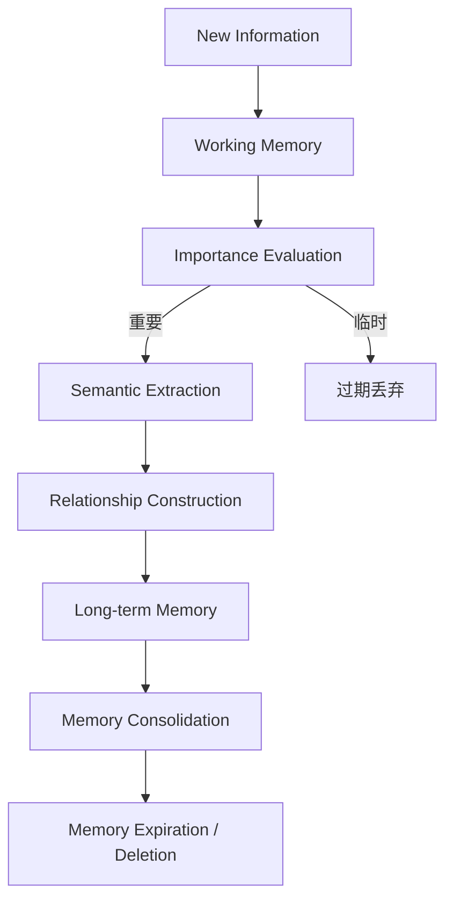

这里需要将记忆提取与记忆持久化分离。

LLM 可以判断某条信息是否值得保存，但最终的写入必须经过权限、来源、版本和数据完整性检查。

### 10.3 Memory 检索

检索时不能只看向量相似度。

可以设计一个综合评分模型：

$$ Score = w_s S_{semantic}+ w_r S_{recency}+ w_i S_{importance}+ w_c S_{context}+ w_t S_{trust} $$

其中：

- \$S_{semantic}\$：语义相关性。
- \$S_{recency}\$：时间新近性。
- \$S_{importance}\$：重要性。
- \$S_{context}\$：当前任务上下文相关性。
- \$S_{trust}\$：信息来源可信度。

权重可以根据工作负载进行配置或学习。

这样，AI 不只是从数据库中寻找相似文本，而是从存储引擎中直接检索与当前任务相关的记忆对象。

## 十一、AI 与存储引擎的边界：安全和确定性

这一部分决定系统能否真正用于生产环境。

AI 的最大问题不是不会生成查询，而是可能生成错误的操作计划。

例如：

- 删除了不应该删除的数据。
- 修改了错误版本的对象。
- 将不同用户的数据混合。
- 因为语义相似而检索到不相关的数据。
- 把不可信文档中的指令当成系统指令。
- 执行了超出用户权限范围的操作。

因此需要一个独立的 Policy Engine。

### 11.1 安全执行架构

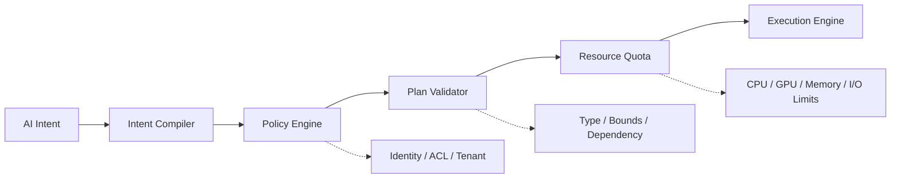

AI 生成的计划必须通过以下检查：

| 检查项                    | 说明          |
| ---------------------- | ----------- |
| Identity               | 当前调用者是谁     |
| Authorization          | 是否有权限访问目标对象 |
| Tenant Isolation       | 是否跨租户访问     |
| Object Scope           | 是否允许操作指定对象  |
| Type Validation        | 操作与对象类型是否匹配 |
| Resource Quota         | 是否超过资源配额    |
| Transaction Validation | 是否满足事务约束    |
| Data Provenance        | 数据来源是否可信    |

### 11.2 高风险操作的执行策略

建议把操作分为三种：

| 操作等级             | 示例         | 执行方式        |
| ---------------- | ---------- | ----------- |
| Read             | 检索、读取、分析   | 自动执行        |
| Controlled Write | 新增记忆、更新知识  | 权限校验后执行     |
| Destructive      | 批量删除、覆盖、清空 | 需要明确授权或二次确认 |

这里必须强调：

AI 可以建议执行操作，但不能绕过存储引擎的权限和事务机制。

## 十二、分布式架构设计

第一版可以先实现单机存储引擎，但是架构需要为分布式扩展预留接口。

### 12.1 分布式总体架构

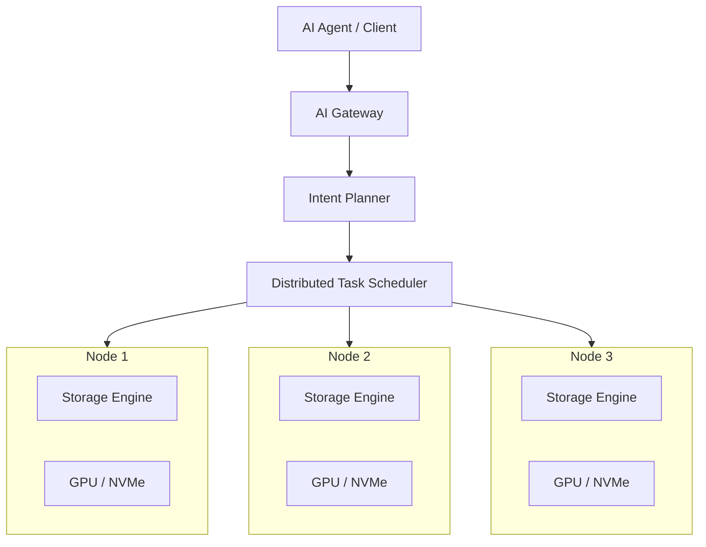

### 12.2 分布式数据管理

建议支持：

- Object Sharding。
- Vector Partitioning。
- Graph Partitioning。
- Tensor Sharding。
- Distributed Memory。
- Replica Management。
- Distributed WAL。
- Snapshot Coordination。

不同数据类型采用不同分片策略。

| 数据类型     | 分片策略                         |
| -------- | ---------------------------- |
| Document | Hash / Range                 |
| Vector   | IVF Partition / Hash         |
| Graph    | Community / Vertex Partition |
| Tensor   | Tensor Dimension / Block     |
| Memory   | Tenant / Agent / Time        |
| Event    | Time Range                   |

尤其是 Graph 和 Vector，不能简单地使用同一套 Hash 分片策略。

因为向量相似度检索和图遍历可能涉及跨节点访问，需要考虑数据局部性和查询放大问题。

### 12.3 分布式一致性

建议分开处理：

1. 对象元数据和事务状态。
2. 向量、图等派生索引。
3. 大型 Tensor 和 Media 数据。

元数据和事务提交需要强一致性保证。

派生索引可以允许有限的异步更新，但必须明确暴露索引可见性水位，不能把尚未同步的索引结果误报为最新结果。

大型数据可以采用不可变版本和引用切换。

第一版不建议实现一个复杂的跨节点全局事务系统。先实现单机事务和多节点数据分布，再逐步增加分布式事务能力。

## 十三、系统对外接口设计：AI API 取代 SQL API

这一层决定用户如何使用系统。

不建议要求用户学习一套新的复杂查询语言。

系统主要提供四类接口：

1. Natural Language API。
2. Intent API。
3. Object API。
4. Workflow API。

### 13.1 Natural Language API

示例：

```
result = await db.ask(    "找出与PostgreSQL逻辑复制并行解码相关的源码函数，"    "分析它们之间的调用关系")
```

用户只需要描述任务。

AI 负责理解意图并调用底层引擎。

但自然语言 API 更适合 Agent 或交互式场景，不应该作为所有程序访问的唯一方式。

### 13.2 Intent API

对于确定性的程序，可以直接提交 Intent。

```
result = await db.execute_intent({    "operation": "retrieve",    "target": "source_code",    "semantic_query": "PostgreSQL parallel logical decoding",    "relations": ["calls", "depends_on"],    "limit": 100})
```

这样可以绕开自然语言理解的不确定性。

### 13.3 Object API

提供底层对象访问：

```
obj = await db.objects.get(object_id)await db.objects.create(    type="document",    content=source_code,    metadata={        "project": "postgresql",        "version": "18"    })await db.objects.update(    object_id=obj.id,    content=updated_content)
```

Object API 是整个系统最基础的程序接口。

### 13.4 Workflow API

支持复杂 Agent 任务：

```
workflow = await db.workflow.create(    name="source_analysis")workflow.add("retrieve", ...)workflow.add("extract_entities", ...)workflow.add("build_graph", ...)workflow.add("save_memory", ...)result = await workflow.run()
```

Workflow 应支持：

- 并行步骤。
- 任务依赖。
- Checkpoint。
- 失败重试。
- 取消。
- 状态查询。
- 结果持久化。

### 13.5 是否彻底废弃 SQL？

我的建议是：

废弃 SQL 作为主要的用户交互和 AI 任务表达方式，但不要在第一版彻底删除 SQL 或结构化访问能力。

原因是：

SQL 仍然具有很高的确定性，适合批量修改、精确过滤、复杂聚合和传统应用迁移。

而且自然语言并不总是适合表达精确条件。

因此可以保留一个可选的兼容接口：

```
AI Interface
     |
     +-- Natural Language
     |
     +-- Intent API
     |
     +-- Object API
     |
     +-- Workflow API
     |
     +-- Optional SQL Compatibility
```

SQL 兼容层只作为边缘接口，不能反过来成为核心执行模型。

## 十四、关键内部模块与代码组织

为了真正实现这套系统，不能只停留在概念架构上。

需要从一开始就划分清晰的内核模块。

建议采用 Rust 实现核心存储引擎，GPU、NVMe 驱动和 AI 模型运行时通过独立适配层接入。

### 14.1 项目目录

```
ains/
│
├── crates/
│   │
│   ├── ains-api/
│   │   ├── natural_language/
│   │   ├── intent/
│   │   ├── object/
│   │   └── workflow/
│   │
│   ├── ains-intelligence/
│   │   ├── semantic/
│   │   ├── planner/
│   │   ├── reasoning/
│   │   └── learning/
│   │
│   ├── ains-ir/
│   │   ├── intent_ir/
│   │   ├── task_dag/
│   │   └── validation/
│   │
│   ├── ains-datamodel/
│   │   ├── object/
│   │   ├── vector/
│   │   ├── graph/
│   │   ├── tensor/
│   │   ├── document/
│   │   ├── memory/
│   │   └── event/
│   │
│   ├── ains-executor/
│   │   ├── scheduler/
│   │   ├── cpu_worker/
│   │   ├── gpu_worker/
│   │   ├── io_worker/
│   │   └── pipeline/
│   │
│   ├── ains-transaction/
│   │   ├── mvcc/
│   │   ├── txn_manager/
│   │   ├── lock_manager/
│   │   └── snapshot/
│   │
│   ├── ains-storage/
│   │   ├── object_store/
│   │   ├── extent/
│   │   ├── layout/
│   │   ├── metadata/
│   │   ├── wal/
│   │   ├── recovery/
│   │   └── compaction/
│   │
│   ├── ains-index/
│   │   ├── vector/
│   │   ├── graph/
│   │   ├── inverted/
│   │   ├── metadata/
│   │   └── hybrid/
│   │
│   ├── ains-memory/
│   │   ├── working/
│   │   ├── episodic/
│   │   ├── semantic/
│   │   └── consolidation/
│   │
│   ├── ains-hardware/
│   │   ├── cpu/
│   │   ├── numa/
│   │   ├── dram/
│   │   ├── gpu/
│   │   ├── nvme/
│   │   ├── io_uring/
│   │   └── spdk/
│   │
│   ├── ains-security/
│   │   ├── identity/
│   │   ├── acl/
│   │   ├── policy/
│   │   └── tenant/
│   │
│   └── ains-distributed/
│       ├── shard/
│       ├── replication/
│       ├── network/
│       └── coordination/
│
├── apps/
│   ├── ains-server/
│   ├── ains-cli/
│   └── ains-admin/
│
├── benchmarks/
│
├── tests/
│
└── docs/
```

### 14.2 模块依赖原则

需要避免模块之间形成循环依赖。

建议依赖方向：

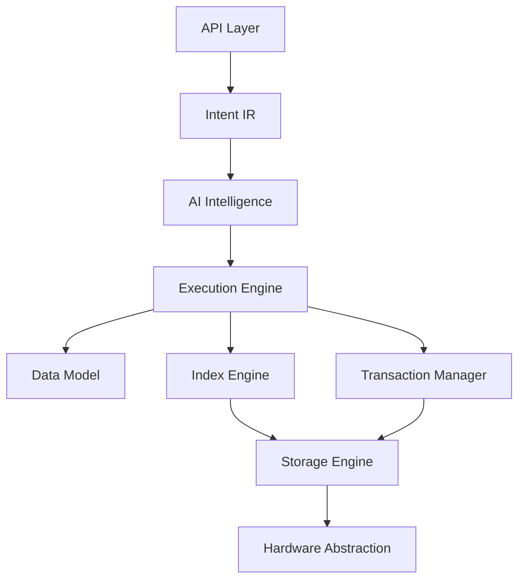

这里的箭头表示依赖方向。

尤其需要注意：

- Storage Engine 不应该依赖 LLM。
- Transaction Manager 不应该依赖 AI。
- Hardware Abstraction 不应该了解 Agent 的概念。
- AI Intelligence 不应该直接依赖物理磁盘结构。
- Intent IR 不应该暴露物理 Page、Block 等内部细节。

这样即使更换 LLM、GPU 或 NVMe 驱动，也不需要修改存储内核的核心实现。

## 十五、核心数据结构与内部接口

下面给出第一版应该定义的核心接口。

### 15.1 Object Store

```
pub trait ObjectStore {
    async fn create(
        &self,
        object: Object,
        txn: &mut StorageTxn,
    ) -> Result<ObjectId>;

    async fn read(
        &self,
        id: ObjectId,
        snapshot: &Snapshot,
    ) -> Result<Object>;

    async fn update(
        &self,
        id: ObjectId,
        object: Object,
        txn: &mut StorageTxn,
    ) -> Result<ObjectVersion>;

    async fn delete(
        &self,
        id: ObjectId,
        txn: &mut StorageTxn,
    ) -> Result<()>;
}
```

### 15.2 Intent Executor

```
pub trait IntentExecutor {
    async fn compile(
        &self,
        intent: Intent,
    ) -> Result<ExecutionPlan>;

    async fn validate(
        &self,
        plan: &ExecutionPlan,
        context: &ExecutionContext,
    ) -> Result<()>;

    async fn execute(
        &self,
        plan: ExecutionPlan,
        context: ExecutionContext,
    ) -> Result<ExecutionResult>;
}
```

### 15.3 Hardware I/O

```
pub trait StorageDevice {
    async fn read(
        &self,
        extent: ExtentId,
        offset: u64,
        length: usize,
    ) -> Result<Buffer>;

    async fn write(
        &self,
        extent: ExtentId,
        offset: u64,
        data: Buffer,
    ) -> Result<()>;

    async fn flush(&self) -> Result<()>;

    async fn discard(
        &self,
        extent: ExtentId,
    ) -> Result<()>;
}
```

不同硬件可以分别实现：

```
StorageDevice
    |
    +-- NvmeIoUringBackend
    |
    +-- NvmeSpdkBackend
    |
    +-- MemoryBackend
    |
    +-- CxlBackend
    |
    +-- GpuStorageBackend
```

这里需要特别区分：

GPU Storage Backend 不等于普通 NVMe Device Backend。GPU HBM 是易失性设备内存，必须由专门的内存管理和数据生命周期机制管理。

> 接口的正式冻结版本（含 `IoExecutor` 同步 façade、错误模型与模块调用方向）见 [04-kernel-interfaces.md](04-kernel-interfaces.md)。

### 15.4 Scheduler

```
pub trait TaskScheduler {
    async fn submit(
        &self,
        task: Task,
    ) -> Result<TaskId>;

    async fn schedule(
        &self,
        dag: ExecutionDag,
    ) -> Result<SchedulePlan>;

    async fn cancel(
        &self,
        task_id: TaskId,
    ) -> Result<()>;
}
```

### 15.5 事务接口

```
pub trait TransactionManager {
    async fn begin(
        &self,
        isolation: IsolationLevel,
    ) -> Result<StorageTxn>;

    async fn commit(
        &self,
        txn: StorageTxn,
    ) -> Result<CommitResult>;

    async fn abort(
        &self,
        txn: StorageTxn,
    ) -> Result<()>;
}
```

这些接口是第一版的逻辑边界。真正编码时，还需要确定对象安全性、异步 I/O 生命周期、Buffer 所有权、取消安全以及 WAL 提交顺序。

> **冻结状态**：本节（15.1–15.5）是**草案**，已被 [04-kernel-interfaces.md](04-kernel-interfaces.md) 取代。其中「对象安全性、异步 I/O 生命周期、Buffer 所有权」三项已在冻结文档中给出答案：`StorageDevice` 用 `#[async_trait]` 保证 dyn 兼容（D0.1）、缓冲区改为借用、`IoExecutor` 是同步 façade（§6.3）；「WAL 提交顺序」见冻结文档 §8 T2 的七步。
>
> `TaskScheduler`（15.4）属于**执行层**而非存储内核，其 async 形态不受「内核同步」的约束；被冻结的只有存储内核的 trait（§3–§11）。

## 十六、AI-Native Storage 与传统数据库的本质区别

把整个架构归纳一下：

| 维度     | 传统数据库                | AI-Native Storage                  |
| ------ | -------------------- | ---------------------------------- |
| 用户入口   | SQL                  | 自然语言 / Intent                      |
| 核心模型   | Relation             | AI Object                          |
| 数据组织   | Row / Column / Page  | Object / Extent / Tensor           |
| 查询模型   | Relational Algebra   | Intent DAG                         |
| 优化模型   | Cost-Based Optimizer | Cost-Based + AI-Assisted           |
| 执行模型   | Tuple / Operator     | Task / Batch / Stream / Tensor     |
| 并行模型   | Query Parallelism    | Task + Data + Hardware Parallelism |
| 内存管理   | Buffer Pool          | Memory Tier Manager                |
| 索引     | B-tree 等             | Vector / Graph / Hybrid            |
| 存储管理   | Heap / Page          | Object / Extent                    |
| 硬件访问   | OS I/O 抽象为主          | Hardware-Aware I/O                 |
| 事务     | SQL Transaction      | Storage Transaction + Workflow     |
| 数据生命周期 | 数据库对象生命周期            | AI Memory / Object Lifecycle       |
| 优化反馈   | SQL 统计信息             | AI Workload Learning               |

最核心的区别不是多了向量索引，也不是多了一个 LLM。

而是整个系统的核心抽象发生了变化：

```
传统数据库：

SQL
  |
  ▼
Relational Algebra
  |
  ▼
Tuple
  |
  ▼
Page
  |
  ▼
Disk
```

```
AI-Native Storage：

AI Intent
  |
  ▼
Intent DAG
  |
  ▼
AI Object / Task
  |
  ▼
Logical Extent
  |
  ▼
Hardware Resource
```

## 十七、落地实施路线

不建议一开始就实现完整的分布式 AI 数据库。

这套系统涉及 AI、存储、事务、硬件、GPU 和分布式计算。如果同时实现，研发风险非常高。

建议分为五个阶段。

### 17.1 五阶段实施规划

Phase 1：AI-Native Storage Core

第一优先级

建立真正独立的存储内核。

- Object Data Model
- Object Store
- Extent Manager
- WAL / Recovery
- MVCC
- NVMe I/O
- DRAM Cache

  交付：能够独立运行、可靠持久化的对象存储引擎。

Phase 2：AI Data Engine

建立 AI 原生数据能力。

- Vector Store
- Document Store
- Graph Store
- Memory Store
- Hybrid Retrieval
- Embedding Pipeline

  交付：支持 AI 知识检索和记忆管理的存储系统。

Phase 3：AI Execution Engine

让 AI 意图真正驱动存储执行。

- Intent IR
- Intent Compiler
- Task DAG
- CPU Worker
- I/O Worker
- Cost Optimizer
- Workflow Runtime

  交付：用户通过 AI Intent 完成复杂数据任务。

Phase 4：Hardware-Native Optimization

发挥专用硬件的性能优势。

- GPU / HBM
- CUDA / HIP
- NUMA
- io_uring / SPDK
- GPUDirect Storage
- Adaptive Data Placement

  交付：CPU、GPU、DRAM、NVMe 协同执行。

Phase 5：Distributed AI Storage

扩展为集群系统。

- Distributed Object Store
- Sharding
- Replication
- Distributed Scheduler
- Remote GPU
- Distributed Memory

  交付：分布式 AI 存储集群。

### 17.2 第一版 MVP 应该实现什么？

我建议第一版不要做一个功能庞大的数据库，而是实现一个真正能体现架构创新的最小系统。

MVP 推荐范围

| 模块    | 第一版实现                             |
| ----- | --------------------------------- |
| 编程语言  | Rust                              |
| 数据模型  | Object / Document / Vector        |
| 数据组织  | Object + Extent                   |
| 持久化   | WAL + Checkpoint                  |
| 事务    | MVCC                              |
| 硬件    | DRAM + NVMe                       |
| I/O   | io_uring                          |
| 缓存    | Object Cache + Vector Cache       |
| 索引    | HNSW + Metadata Index             |
| 执行器   | CPU Worker + I/O Worker           |
| AI 接口 | Intent API + Natural Language API |
| AI 模型 | 外部 LLM，通过 Provider 接入             |
| 检索    | Vector + Keyword + Metadata       |
| 事务恢复  | WAL Replay + Object Recovery      |

第一版先不实现：

- 分布式事务。
- 完整 GPU 存储后端。
- CXL。
- RDMA。
- 完整 Graph Engine。
- 自研 LLM。
- 自研 Embedding 模型。
- 自动化 AI 数据布局优化。

这些功能都可以在架构中预留扩展点。

## 十八、性能设计与验收标准

这类系统不能只验证 AI 能不能正确回答问题。

还必须验证存储引擎是否真正比传统方案更有效。

建议建立独立 Benchmark。

### 18.1 基础存储 Benchmark

| 测试项目                   | 验证内容     |
| ---------------------- | -------- |
| Random Object Read     | 随机对象读取   |
| Sequential Object Read | 连续对象读取   |
| Object Write           | 对象写入     |
| Batch Write            | 批量对象写入   |
| Concurrent Read        | 并发读取     |
| Concurrent Update      | 并发更新     |
| WAL Throughput         | WAL 写入吞吐 |
| Recovery Time          | 崩溃恢复时间   |

### 18.2 AI 工作负载 Benchmark

| 测试项目               | 验证内容         |
| ------------------ | ------------ |
| Vector Search      | 向量检索延迟、召回率   |
| Hybrid Retrieval   | 混合检索性能       |
| RAG Retrieval      | 上下文召回能力      |
| Graph Traversal    | 关系遍历效率       |
| Tensor Read        | Tensor 读取吞吐  |
| Memory Retrieval   | 记忆检索效率       |
| Multi-Agent Access | 多 Agent 并发访问 |
| Workflow Recovery  | 长任务恢复能力      |

### 18.3 硬件效率 Benchmark

需要重点记录：

- CPU 利用率。
- GPU 利用率。
- DRAM 带宽。
- NUMA 跨节点访问量。
- NVMe IOPS。
- NVMe 带宽。
- I/O 队列深度。
- 内存复制量。
- GPU 数据传输量。
- 每次检索的能耗和成本（硬件条件允许时）。

最重要的是做同硬件、同数据、同召回率条件下的对照实验。

例如：

```
Test A:
Traditional Vector Database
    |
    +-- Buffer Pool
    +-- CPU Search
    +-- NVMe

Test B:
AI-Native Storage
    |
    +-- Object Cache
    +-- Hardware-Aware I/O
    +-- Batch Search
    +-- GPU Search
```

比较的不能只是 QPS。

还需要比较 P50、P95、P99 延迟、召回率、资源利用率、写入放大、恢复时间和整体成本。

## 十九、几个必须提前解决的架构问题

我认为这套设计中还有六个关键问题，需要在正式进入编码前形成明确的技术决策。

| 问题                 | 我的建议                             | 重要程度 |
| ------------------ | -------------------------------- | ---- |
| AI 是否直接参与执行？       | 只生成和调整经过验证的计划                    | 极高   |
| 是否完全废弃 SQL？        | 核心不依赖 SQL，保留兼容接口                 | 高    |
| 是否使用 Page？         | 不将 Page 作为核心数据模型，但允许底层块管理使用固定大小页 | 高    |
| 是否让 GPU 直接访问 NVMe？ | 后续通过 GPUDirect Storage 等技术实现     | 高    |
| 是否让 AI 管理数据布局？     | AI 提出建议，确定性内核执行迁移                | 高    |
| 是否采用统一数据格式？        | 统一 Object Header，Payload 按类型专门设计 | 极高   |

此外，还有三个值得特别研究的技术方向。

1. GPU 是否应该成为存储执行引擎的一部分？

传统数据库把 GPU 当作外部计算设备。

而 AI-Native Storage 可以让 GPU 成为一等计算资源，存储系统根据数据所在位置直接调度计算，尽量避免 CPU 中转。

但 GPU 不应该承担事务协调、WAL 恢复和所有元数据管理。

2. 是否应该让存储引擎拥有自己的 AI 模型运行时？

我的建议是第一版不要内置 LLM Runtime。

通过统一 Model Provider 接口接入外部模型，未来再支持本地推理、GPU 推理和模型缓存。

否则存储内核会同时承担数据库研发和模型推理框架研发，范围过大。

3. 数据是否需要针对 AI 模型重新组织？

我认为需要。

例如模型推理的 KV Cache、Embedding、Tensor 和上下文数据，具有不同的访问生命周期、读取粒度和内存带宽要求。

未来可以设计 Model-Aware Layout，让数据布局能够感知模型访问模式，而不仅仅是感知数据类型。

## 二十、最终架构定位

我建议将这个项目定义为：

### AI-Native Storage System

### A storage engine designed for AI workloads and hardware-native execution.

核心架构：

### AI as the Interface

Natural Language / Agent / Intent

### Intent as the Execution Model

Intent IR / DAG / Task Scheduling

### Object as the Data Model

Vector / Graph / Tensor / Memory / Document

### Extent as the Storage Model

Object Layout / Version / Index / Persistence

### Hardware as the Execution Foundation

CPU / DRAM / GPU / HBM / NVMe / CXL

我的核心判断是：

真正的 AI-Native Database 不应该是一个能够理解 SQL 的 AI 数据库，而应该是一个以 AI 数据访问模式为基础，重新设计数据模型、执行模型、存储模型和硬件访问模型的系统。

它的核心创新应该落在三个地方：

1. Data Model Innovation：从关系数据转向 AI Object。
2. Execution Model Innovation：从 SQL 执行计划转向 Intent DAG。
3. Storage Architecture Innovation：从通用 Page/Buffer 模型转向 Hardware-Aware Object/Extent 模型。

这三个创新必须同时成立，才能真正区别于现有的向量数据库、RAG 数据库和传统数据库加 LLM 的方案。

## 二十一、下一步重点做的事情

不要马上开始编写全部模块。先把存储内核的几个根本性设计确定下来：

1. Object、Extent、Physical Block 三层数据组织及映射关系。
2. DRAM、NVMe、GPU HBM 的统一资源管理和数据迁移机制。
3. Object Version、MVCC、WAL、Checkpoint 的一致性设计。
4. Intent IR、Task DAG 与底层存储执行器的接口。
5. 从传统 Buffer Manager 转向 Hardware-Aware Storage Manager 的内部实现。

其中最值得先深入研究的是第三、第二和第一项。 因为这三项决定了它最终是一个真正独立的存储引擎，还是仅仅一个运行在传统数据库之上的 AI 服务。
