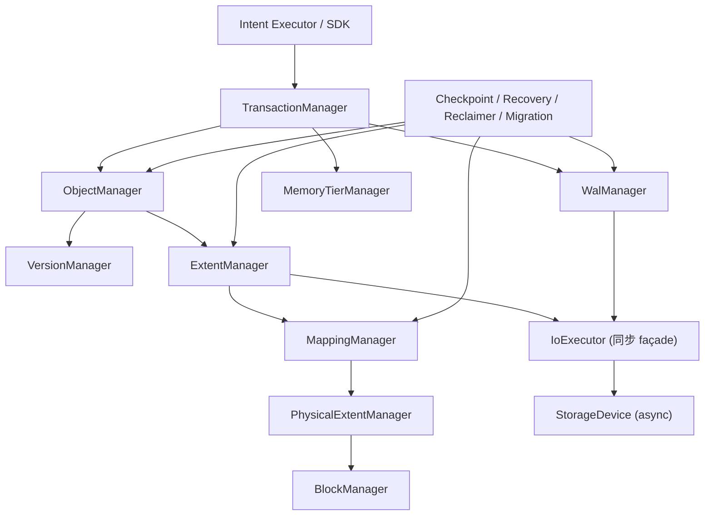

# AINS 内核接口冻结 —— Rust trait、错误类型与模块调用链

> 本文承接 [02-kernel.md](02-kernel.md) 与 [03-consistency-kernel.md](03-consistency-kernel.md)：
> 前两篇确定了「数据怎么组织」「一致性怎么保证」，本文把这两篇的结论落成**可以直接开写代码的接口契约**：
> 模块边界、trait 形状、错误类型、调用方向、锁顺序，以及「接口一旦冻结，什么情况下才能改」。
>
> 状态：设计阶段 · 接口冻结草案 v1 · 变更需走 [ADR](../adr/0008-kernel-interface-freeze.md)

## 一、本文要冻结什么

### 1.1 为什么需要接口冻结

内核是整个系统里唯一「错了就丢数据」的部分。上层 Intent 执行器、索引网格、Agent 运行时都可以演进，唯独内核的接口一旦被依赖，就不能再随手改：

- 改一个 trait 的返回类型，会同时改动 Object Manager、Extent Manager、WAL Manager、Recovery 与测试夹具；
- 改一个错误的语义，会同时改变客户端的重试策略和运维告警的分类；
- 改一个锁的持有范围，会同时改变读延迟和死锁风险。

因此本文只冻结**契约**，不冻结**实现**。

### 1.2 冻结清单

| 编号 | 契约对象 | 所属模块 | 冻结内容 | 变更方式 |
|---|---|---|---|---|
| F1 | 类型标识符 | 全局 | `ObjectId` / `VersionId` / `TransactionId` / `Lsn` / `ExtentId` / `MappingId` / `PhysicalExtentId` / `SnapshotId` 的语义与作用域 | ADR |
| F2 | 错误模型 | 全局 | `KernelError` 的变体、分类、可重试性、错误映射规则 | ADR |
| F3 | `ObjectManager` | 对象层 | 对象与版本的读写、发布、删除的入口形状 | ADR |
| F4 | `ExtentManager` | 逻辑层 | 逻辑 extent 的切分、分配、释放 | ADR |
| F5 | `MappingManager` | 映射层 | 逻辑→物理映射的解析、切换、版本语义 | ADR |
| F6 | `StorageDevice` / `IoExecutor` | 硬件层 | 设备读写、flush、耐久等级、故障上报；同步 façade 与 async HAL 的边界 | ADR |
| F7 | `WalManager` | 日志层 | 追加、flush、水位、扫描 | ADR |
| F8 | `TransactionManager` | 事务层 | 事务生命周期、快照、可见性、冲突处理 | ADR |
| F9 | `CheckpointManager` / `RecoveryManager` | 恢复层 | 检查点发布与崩溃恢复的入口 | ADR |
| F10 | `Reclaimer` | 回收层 | 六条件判定与空间回收 | ADR |
| F11 | `MigrationManager` | 迁移层 | 迁移计划、执行、状态查询 | ADR |
| F12 | `MemoryTierManager` | 资源层 | 内存/设备空间分配与释放 | ADR |
| F13 | 模块调用方向 | 全局 | 允许的依赖边、禁止的反向依赖、锁顺序 | ADR |
| F14 | 公共 API 表面 | 全局 | 公共类型只能暴露逻辑标识符，禁止暴露物理地址 | ADR |

### 1.3 明确不冻结的内容

以下内容由实现自由决定，本文不约束：

- 具体的数据结构布局（`Vec` 还是 `SmallVec`，锁用 `parking_lot` 还是自旋锁）；
- 线程模型细节（工作线程数量、NUMA 亲和如何设置）；
- 缓存与淘汰算法的具体实现；
- 序列化格式的字段顺序（只要与 [03 §2.2](03-consistency-kernel.md) 的帧格式兼容）；
- 性能参数（批量大小、队列深度、阈值）。

**判断标准**：如果一个改动只影响「怎么实现」，不冻结；如果影响「谁必须调用谁、失败时返回什么、调用方该怎么处理」，就冻结。

## 二、通用类型与错误模型

### 2.1 标识符类型

```rust
pub struct ObjectId { pub database_id: u32, pub sequence: u64 }
pub struct VersionId(pub u64);        // 仅在 ObjectId 作用域内单调
pub struct TransactionId(pub u64);   // 全局 xid
pub struct Lsn(pub u64);             // WAL 逻辑字节偏移
pub struct ExtentId(pub u64);        // Logical Extent
pub struct PhysicalExtentId(pub u64);
pub struct MappingId(pub u64);
pub struct MappingVersion(pub u64);  // 单个 Extent 内部的映射代次
pub struct SnapshotId(pub u64);
pub struct ComponentId(pub u32);
```

六条硬性规则（与 [03 §1.2](03-consistency-kernel.md) 一致）：

```
F1.1  ObjectId 全局稳定，永不复用。
F1.2  VersionId 只在 ObjectId 作用域内单调，禁止跨对象比较。
F1.3  Lsn 只描述 WAL 写入先后，不描述提交顺序。
F1.4  MappingVersion 只在 ExtentId 作用域内单调。
F1.5  TransactionId 单调递增分配，回收的 xid 槽位不得再被使用。
F1.6  任何持久化结构只能存逻辑标识符，禁止存裸 LBA / 裸虚拟地址。
```

`VersionId`、`Lsn`、`MappingVersion` 三个类型**故意不实现 `Ord` 的跨类型比较**：Rust 的 `Ord` 是全序，跨作用域比较没有意义，容易在评审中被误用。若某个比较确实需要，只能由持有作用域的模块显式提供 `fn visible_version_in(&self, snap: &Snapshot) -> bool` 这类语义化函数。

### 2.2 顶层错误类型

```rust
#[non_exhaustive]
pub enum KernelError {
    /// 逻辑对象/版本/extent 不存在
    NotFound { kind: IdKind, id: String },

    /// 对象已存在且不允许覆盖（COW 语义下的重复创建）
    AlreadyExists { kind: IdKind, id: String },

    /// 与其他事务的写冲突：调用方需要决定是否重试
    Conflict(ConflictKind),

    /// 瞬时故障：调用方可按退避策略重试
    Retryable(RetryReason),

    /// 数据损坏：不允许静默继续
    Corrupted(CorruptionKind),

    /// 资源不足（容量、内存域、句柄）
    ResourceExhausted { resource: ResourceKind },

    /// 第一版不支持的能力
    Unsupported { feature: &'static str },

    /// 设备 I/O 失败
    Io { op: IoOp, source: std::io::Error },

    /// 不变量被破坏：属于内核 bug，必须 panic 或 abort，不允许返回给调用方
    Internal { code: InternalCode, detail: String },
}

pub type KernelResult<T> = Result<T, KernelError>;
```

`#[non_exhaustive]` 是有意为之：它允许后续版本新增变体而不破坏调用方的 `match`（调用方必须带 `_ =>` 分支），代价是调用方不能穷尽匹配——这正是我们要的，因为错误分类需要随实现演进。

### 2.3 错误分类与调用方动作

| 变体 | 语义 | 调用方应当做什么 | 是否可自动重试 |
|---|---|---|---|
| `NotFound` | 逻辑对象不存在 | 视业务语义决定；读路径返回 404 | 否 |
| `AlreadyExists` | 重复创建 | 合并或改名 | 否 |
| `Conflict` | 与已提交/并发事务冲突 | **由上层决定**：重试整个工作流，或显式暴露冲突 | 否（内核内禁止自动重试） |
| `Retryable` | 瞬时故障 | 指数退避重试，次数上限由 SDK 层控制 | 是 |
| `Corrupted` | 校验和不匹配、链断裂 | 不得继续；触发恢复流程并告警 | 否 |
| `ResourceExhausted` | 容量/内存不足 | 触发回收或扩容后重试 | 视情况 |
| `Unsupported` | 第一版不实现 | 走降级路径 | 否 |
| `Io` | 设备错误 | 按 `op` 判断是否可重试 | 视 `op` |
| `Internal` | 不变量被破坏 | 不应出现；出现即 bug | 否 |

三条关键约定：

**C1：内核内部不自动重试写冲突。** `Conflict` 必须原样返回给上层。如果内核悄悄重试，AI 工作流层就无法知道「这次写入失败过」，也无法决定是重试、换路径还是交给用户。自动重试只允许发生在 `Retryable` 分支上。

**C2：`Io` 必须携带 `op`。** `IoOp` 至少包含 `Read` / `Write` / `Flush` / `Fsync` / `Rename` / `Allocate`，因为故障注入测试要按「第 N 次 flush 后 kill」来定位（[03 §11.3](03-consistency-kernel.md)）。

**C3：错误里禁止出现物理地址。** `KernelError` 的任何字段都不得携带 LBA、虚拟地址或设备偏移——故障诊断需要物理位置时，由调用方用自己的 `MappingId` 再查一次映射表。

### 2.4 错误映射规则

每个模块只允许返回与自身职责相关的错误子集：

| 模块 | 允许返回 | 禁止返回 |
|---|---|---|
| `ObjectManager` | `NotFound` / `AlreadyExists` / `Conflict` / `Unsupported` / `Internal` | `Io`（对象层不直接碰设备） |
| `ExtentManager` | `NotFound` / `ResourceExhausted` / `Unsupported` / `Internal` | `Io`（设备错误由 `StorageDevice` 包装后上传） |
| `MappingManager` | `NotFound` / `Conflict(MappingChanged)` / `Internal` | `Io` |
| `WalManager` | `Io` / `Corrupted` / `ResourceExhausted` / `Internal` | `NotFound` |
| `TransactionManager` | `Conflict` / `Retryable` / `Internal` | `Io` / `Corrupted` |
| `StorageDevice` | `Io` / `Unsupported` / `Internal` | 其余全部 |
| `CheckpointManager` | `Io` / `Corrupted` / `ResourceExhausted` / `Internal` | `NotFound` |
| `Reclaimer` | `Conflict` / `Internal` | `Io` / `NotFound` |

「设备错误由 `StorageDevice` 包装后上传」的具体含义：设备层把 I/O 失败转成 `KernelError::Io` 或触发设备降级（`DurabilityLevel` 下降、设备被标记故障），再由上层决定是重试、切换副本还是返回错误。对象层永远看不到裸 `io::Error`。

### 2.5 核心内核同步，设备 HAL 是唯一的 async 边界

内核的**核心模块**（Object / Extent / Mapping / Transaction / WAL / Checkpoint / Reclaimer / Migration / MemoryTier）全部是**同步**的：

```rust
pub trait ObjectManager: Send + Sync { /* 全部同步方法 */ }
```

理由：

- 内核的临界区短、调用链深（Object → Extent → Mapping → Device），异步化会让锁语义与可读性同时恶化；
- WAL 的 durability 语义建立在「调用返回即已持久」的同步契约上，async 会把这个契约变成「await 之后才持久」，更难证明；
- 真正需要异步的是设备 I/O 与上层（Agent 任务、网络服务）。

但**设备 HAL 是例外**：[01-overview §15.3](01-overview.md) 与 [ADR-0004](../adr/0004-bypass-kernel-io.md) 已经确定 `StorageDevice` 是 async 的（io_uring / SPDK 天生是完成通知模型）。因此冻结为：

| 层 | async？ | 说明 |
|---|---|---|
| 上层（Agent / SDK / 网络服务） | 是 | 任务级并发 |
| 核心内核模块 | **否** | 本文 §3–§11 的全部 trait |
| 设备 HAL（`StorageDevice`） | **是** | io_uring / SPDK 后端 |
| 桥接层（`IoExecutor`） | 同步 façade | 核心内核唯一接触 async 的地方 |

`IoExecutor` 的职责：把设备操作提交给常驻的 I/O reactor 线程（每 NUMA 节点一个），并在完成事件上阻塞调用方，使核心内核保持「调用返回即已完成」的同步语义。

因此：**除 `StorageDevice` 与设备后端内部外，任何 trait 都不允许出现 `async fn`**。上层若需要并发访问，通过「每个连接/每个任务一个内核句柄」实现。

## 三、Object Manager 与 Version Manager

### 3.1 职责边界

沿用 [02-kernel §9.1](02-kernel.md) 的划分，并补充契约：

| 模块 | 负责 | 不负责 | 本文的 trait |
|---|---|---|---|
| Object Manager | 对象创建、读取、更新入口 | 硬件分配、设备 I/O | `ObjectManager` |
| Version Manager | 版本链、版本可见性、版本状态 | 数据 I/O、extent 切分 | （内部）`VersionManager` |

两者在实现上可以是同一个结构体，但**接口上必须分开**：写路径只能经 `ObjectManager` 进入，版本链的遍历与可见性判定只能在 `VersionManager` 内部发生。

### 3.2 `ObjectManager`

```rust
pub trait ObjectManager: Send + Sync {
    /// 创建对象（幂等键由上层负责，此处不做语义去重）
    fn create_object(&self, req: &CreateObjectRequest) -> KernelResult<ObjectId>;

    /// 读取对象头（不含 payload）
    fn get_header(&self, id: ObjectId) -> KernelResult<ObjectHeader>;

    /// 在快照下解析可见版本；不可见时返回 NotFound
    fn resolve_version(&self, id: ObjectId, snap: &Snapshot) -> KernelResult<VersionId>;

    /// 读取指定版本的元数据视图（payload 按需通过 ExtentManager 读取）
    fn read_version(&self, id: ObjectId, ver: VersionId) -> KernelResult<ObjectView>;

    /// 在事务上下文中生成新版本（未提交前不可见）
    fn stage_version(&self, txn: &mut TxnCtx, id: ObjectId, spec: &VersionSpec)
        -> KernelResult<VersionId>;

    /// 标记对象删除（设置 xmax，不做物理删除）
    fn delete_object(&self, txn: &mut TxnCtx, id: ObjectId) -> KernelResult<()>;
}
```

三条语义约束：

**O1：`stage_version` 不产生任何对外可见性。** 新版本在事务提交前处于 `VersionState::Pending`，任何其他事务的 `resolve_version` 都看不到它。

**O2：版本发布与事务提交是同一个原子点。** 提交成功的定义是：WAL 提交记录已持久 + 内存状态已切换。二者顺序固定为「先持久后发布」（[03 §2.4](03-consistency-kernel.md) 的写入顺序），不允许反过来。

**O3：`stage_version` 只能通过 COW 产生新 extent。** 已发布的 extent 内容不可原地修改；未修改的 extent 在新版本中共享（[02-kernel §4.5](02-kernel.md)）。

### 3.3 事务上下文

```rust
pub struct TxnCtx {
    pub xid: TransactionId,
    pub snapshot: Snapshot,
    pub write_set: WriteSet,       // 待提交的 (ObjectId, VersionId)
    pub start_lsn: Lsn,
}
```

`TxnCtx` 是内核内部唯一允许跨模块传递的可变状态载体。它的作用是把「这次写入属于哪个事务」这件事显式化，避免各模块各自维护事务上下文导致的不一致。

## 四、Extent Manager

### 4.1 职责

| 模块 | 负责 | 不负责 |
|---|---|---|
| Extent Manager | 逻辑数据切分、逻辑 extent 元数据 | 设备选择、物理分配 |
| Physical Extent Manager | 物理空间分配 | AI 语义理解 |
| Block Manager | 硬件块定位与分配 | 事务可见性 |

### 4.2 `ExtentManager`

```rust
pub trait ExtentManager: Send + Sync {
    /// 按数据类型把组件切分成逻辑 extent
    fn split(&self, id: ObjectId, comp: ComponentId, layout: LayoutType)
        -> KernelResult<Vec<ExtentId>>;

    /// 为写入准备新的逻辑 extent（内容由调用方随后写入）
    fn allocate_logical(&self, txn: &mut TxnCtx, spec: &ExtentSpec)
        -> KernelResult<ExtentId>;

    /// 把 extent 的内容写入设备并达到要求的耐久等级
    fn write_payload(&self, ext: ExtentId, data: &PayloadRef, dur: DurabilityLevel)
        -> KernelResult<()>;

    /// 读取 extent 内容
    fn read_payload(&self, ext: ExtentId, range: Range<u64>) -> KernelResult<PayloadRef>;

    /// 释放逻辑 extent（仅在 GC 判定通过后调用）
    fn release(&self, ext: ExtentId) -> KernelResult<()>;
}
```

**E1：Extent 的写入与事务提交分离。** `write_payload` 只是把数据落到设备并 flush，不产生版本，也不受事务可见性影响；事务性由 `TxnCtx` 中的 WAL 记录与版本发布保证。

**E2：`release` 只能由 `Reclaimer` 调用。** 逻辑 extent 的释放必须通过 [03 §8](03-consistency-kernel.md) 的六条件判定，接口层面用可见性控制：`release` 是 `pub(crate)`，跨模块只暴露给 `Reclaimer`。

**E3：`read_payload` 不返回原始指针。** 返回的是逻辑引用（`PayloadRef`），真实位置由 `MappingManager` 解析后交给设备层，避免物理地址泄漏到上层（对应 F14）。

## 五、Mapping Manager

### 5.1 职责

| 模块 | 负责 | 不负责 |
|---|---|---|
| Mapping Manager | 逻辑→物理映射、映射代次、原子切换 | 迁移决策（属于 Placement / Migration） |

### 5.2 `MappingManager`

```rust
pub trait MappingManager: Send + Sync {
    /// 在给定映射版本下解析物理位置（调用方必须固定版本）
    fn resolve(&self, ext: ExtentId, mv: MappingVersion) -> KernelResult<PhysicalLocation>;

    /// 创建新映射（分配阶段，尚未生效）
    fn create_mapping(&self, txn: &mut TxnCtx, ext: ExtentId, pe: PhysicalExtentId)
        -> KernelResult<MappingId>;

    /// 原子切换映射：这是迁移的唯一提交点
    fn switch_mapping(&self, txn: &mut TxnCtx, ext: ExtentId,
                      expected: MappingVersion, new: MappingId)
        -> KernelResult<MappingVersion>;

    /// 读取当前映射版本（O(1)，读路径热点的第一跳）
    fn current_version(&self, ext: ExtentId) -> KernelResult<MappingVersion>;
}
```

**M1：`resolve` 必须带显式 `MappingVersion`。** 不提供「按当前版本解析」的简化接口——正是这个简化会导致读取过程中物理位置突变（[02-kernel §2.4](02-kernel.md)）。读路径的固定写法是：

```rust
let mv = mapping.current_version(ext)?;      // 取一次
let loc = mapping.resolve(ext, mv)?;         // 用这个版本读完全程
```

**M2：`switch_mapping` 的 `expected` 是乐观并发检查点。** 若当前版本已不是 `expected`，返回 `Conflict(MappingChanged)`，调用方必须放弃本次迁移（[03 §7.2](03-consistency-kernel.md)）。

**M3：映射切换先于内存发布。** `switch_mapping` 内部顺序固定为：写 `MappingSwitch` WAL 记录 → flush → 更新内存映射表 → 旧版本进入 `Draining`。

## 六、设备层

### 6.1 `StorageDevice`

在 [01-overview §15.3](01-overview.md) 的基础上补齐耐久等级与健康状态：

```rust
pub trait StorageDevice: Send + Sync {
    /// 设备标识与能力
    fn descriptor(&self) -> &DeviceDescriptor;

    /// 顺序写一段数据（不保证持久）
    async fn write(&self, loc: &PhysicalLocation, buf: &[u8]) -> KernelResult<()>;

    /// 读取一段数据
    async fn read(&self, loc: &PhysicalLocation, buf: &mut [u8]) -> KernelResult<()>;

    /// 刷盘到指定耐久等级
    async fn flush(&self, loc: &PhysicalLocation, level: DurabilityLevel) -> KernelResult<()>;

    /// 当前可达的最高耐久等级（设备降级后下降）
    fn max_durability(&self) -> DurabilityLevel;

    /// 报告设备健康状态（后台采集，也可被查询）
    fn health(&self) -> DeviceHealth;
}
```

**D0：本 trait 就是 [ADR-0004](../adr/0004-bypass-kernel-io.md) 定义的 Storage HAL，也是内核里唯一允许 `async fn` 的 trait。** 后端实现优先级（io_uring → SPDK → `preadv2` 回退）与能力探测见 [architecture/04 §2](../architecture/04-hardware-path.md)，回退矩阵见 [architecture/04 §8](../architecture/04-hardware-path.md)。所有后端必须通过同一套语义测试。

**D1：设备层不感知事务。** `StorageDevice` 的签名里没有 `xid`、没有 `lsn`、没有 `snapshot`。事务语义完全由上层的 WAL + 版本机制提供。

**D2：耐久等级是显式参数，不是隐含行为。** `DurabilityLevel` 至少包含 `None`（仅在内存 / 易失设备）、`Write`（已下发到设备缓存）、`Durable`（已落到持久介质）。第一版**禁止**隐式 flush：`write` 不带隐式持久化保证。

**D3：设备降级必须可见。** 设备故障或降级后 `max_durability()` 必须下降，且 `health()` 必须报告 `Degraded`/`Failed`。上层据此决定是否把数据复制到别处。

### 6.2 `MemoryTierManager`

```rust
pub trait MemoryTierManager: Send + Sync {
    /// 在指定资源域分配空间
    fn allocate(&self, req: &MemoryAllocationRequest) -> KernelResult<MemoryAllocation>;

    /// 释放空间
    fn free(&self, alloc: AllocationId) -> KernelResult<()>;

    /// 查询资源域状态（容量、压力、故障）
    fn stats(&self, resource: ResourceId) -> KernelResult<ResourceStats>;
}
```

统一的是**管理接口与资源生命周期**，不是底层分配算法：DRAM 用 NUMA-aware 分配器，GPU 用 CUDA/HIP 分配器，NVMe 用 extent 分配器，CXL 用其设备管理接口（[02-kernel §3.6](02-kernel.md)）。

### 6.3 `IoExecutor`（同步 façade）

设备 HAL 是 async 的，核心内核是同步的，桥接这两者的只有一个组件：

```rust
pub trait IoExecutor: Send + Sync {
    /// 提交一次设备操作并等待完成（阻塞调用方）
    fn submit_and_wait(&self, op: DeviceOp) -> KernelResult<DeviceResult>;

    /// 批量提交并等待全部完成（写路径的批量化入口）
    fn submit_batch_and_wait(&self, ops: &[DeviceOp]) -> KernelResult<Vec<DeviceResult>>;
}
```

**I1：每个 NUMA 节点一个 reactor 线程。** 提交时把操作投递给该 NUMA 节点上的 reactor，由它调用 `StorageDevice` 的 async 方法；完成后唤醒阻塞中的调用方。

**I2：`submit_and_wait` 的完成语义等价于同步调用。** 调用返回时，设备操作已经完成（写已下发、flush 已落盘），错误已按 §2.3 分类。这保证核心内核的「调用返回即已持久」契约不被 async 破坏。

**I3：核心内核只通过 `IoExecutor` 触达设备。** `ExtentManager::write_payload`、`WalManager::flush_upto` 等同步方法内部使用 `IoExecutor`，不直接持有 `StorageDevice`。

**I4：reactor 不持有内核锁。** reactor 只做「提交 → 等完成 → 回调」，不触碰版本链、映射表与目录锁；回调只投递完成事件（§2.5 的「禁止持锁做 I/O」在 reactor 侧同样成立）。

## 七、WAL Manager

```rust
pub trait WalManager: Send + Sync {
    /// 追加一条记录，返回其 LSN（不保证已持久）
    fn append(&self, rec: &WalRecord) -> KernelResult<Lsn>;

    /// 刷盘到目标 LSN，返回时保证 target_lsn 及之前的记录已持久
    fn flush_upto(&self, target: Lsn) -> KernelResult<()>;

    /// 当前已确认持久的水位
    fn durable_lsn(&self) -> Lsn;

    /// 从指定 LSN 开始扫描有效记录（恢复用；遇损坏即终止并返回终止 LSN）
    fn scan_from(&self, from: Lsn) -> KernelResult<WalScan>;

    /// 计算可截断边界（低于该 LSN 的段在满足条件后可删除）
    fn min_required_lsn(&self) -> Lsn;
}
```

**W1：`append` 不隐含 flush。** 提交路径显式调用 `flush_upto(commit_lsn)`；第一版每次提交单独 flush，组提交作为后续优化（[03 §2.5](03-consistency-kernel.md)）。

**W2：`scan_from` 遇到损坏必须停止而不是跳过。** 跳过会让恢复静默丢失记录；停止则尾部损坏被正确识别为「崩溃点」，这是正常情况而不是错误。

**W3：WAL 里只有元数据。** 大 payload 不进 WAL；WAL 只记录版本、映射、分配与校验和（[02-kernel §5.3](02-kernel.md)）。

## 八、Transaction Manager

```rust
pub trait TransactionManager: Send + Sync {
    /// 开始事务，分配 xid 并建立快照
    fn begin(&self, mode: TxnMode) -> KernelResult<TxnCtx>;

    /// 提交：WAL 持久 + 内存发布
    fn commit(&self, txn: &mut TxnCtx) -> KernelResult<CommitReceipt>;

    /// 中止
    fn abort(&self, txn: &mut TxnCtx) -> KernelResult<()>;

    /// 版本可见性判定（纯函数、无 IO、无锁）
    fn visible(&self, ver: &ObjectVersion, snap: &Snapshot) -> bool;

    /// 查询事务状态（供恢复与可见性判定使用）
    fn status(&self, xid: TransactionId) -> TxnStatus;
}
```

**T1：可见性只由 xid + 事务状态决定。** 不使用 `VersionId`、`Lsn` 或时间戳近似（[03 §1.1 R3](03-consistency-kernel.md)）。`visible` 是纯函数且不取任何锁——它是读路径上唯一每版本都要执行的热点。

**T2：提交顺序固定。** `commit` 内部：

```
1. 写全部依赖 WAL 记录（版本 / 映射 / 分配）
2. 写 TxnCommit 记录，得到 commit_lsn
3. flush_upto(commit_lsn)          ← 持久化屏障
4. 发布内存版本（Pending → Published）
5. 返回 CommitReceipt
```

**T3：冲突用 Wait-Die，不做死锁检测。** 写冲突返回 `Conflict(WriteConflict)`，由上层决定重试；内核不自动重试（C1）。

**T4：长事务影响 `xmin` 推进。** 事务状态数组是环形复用（`xid mod RING_SIZE`），最老可复用 xid 由 `xmin` 决定；长事务撑爆窗口时返回 `Retryable(ResourceBusy)`，而不是放宽可见性规则。

## 九、Checkpoint 与 Recovery

```rust
pub trait CheckpointManager: Send + Sync {
    /// 触发一次检查点（异步，返回 checkpoint_id）
    fn trigger(&self) -> KernelResult<CheckpointId>;

    /// 查询当前已发布的检查点
    fn current(&self) -> KernelResult<CheckpointInfo>;

    /// 计算可删除的旧检查点 / WAL 段
    fn reclaim_candidates(&self) -> KernelResult<ReclaimPlan>;
}

pub trait RecoveryManager: Send + Sync {
    /// 启动时执行恢复，返回恢复后的内存状态
    fn recover(&self) -> KernelResult<RecoveredState>;

    /// 校验当前状态的一致性（测试与运维巡检共用）
    fn verify(&self, scope: VerifyScope) -> KernelResult<VerifyReport>;
}
```

**K1：检查点是影子文件 + 原子发布。** 三阶段算法（Capture / Snapshot&Write / Publish）见 [03 §5.2](03-consistency-kernel.md)；`CheckpointManager` 不暴露「原地修改检查点」的接口。

**K2：恢复只前滚，不回滚。** 未提交事务不做 undo，靠 MVCC 可见性 + GC 清理（[03 §6.3](03-consistency-kernel.md)）。

**K3：`verify` 是测试与运维共用的唯一校验实现。** 故障注入测试不能用「人眼对比」判定正确性（[03 §11.3](03-consistency-kernel.md)）。

## 十、Reclaimer（GC）

```rust
pub trait Reclaimer: Send + Sync {
    /// 扫描候选（只读，不改变状态）
    fn scan(&self, budget: ScanBudget) -> KernelResult<Vec<ReclaimCandidate>>;

    /// 对单个对象执行六条件判定
    fn judge(&self, cand: &ReclaimCandidate) -> KernelResult<ReclaimDecision>;

    /// 执行回收：先注销引用，再释放物理空间
    fn reclaim(&self, cand: &ReclaimCandidate) -> KernelResult<()>;
}
```

**R1：判定与执行分离。** `judge` 必须是纯判定（不释放任何东西），`reclaim` 才是副作用。这样判定可以被并发地做多遍而不互相干扰。

**R2：判定必须在快照式视图上做。** 否则「判定通过」到「执行回收」之间可能加入新读者（[03 §8](03-consistency-kernel.md)）。

**R3：顺序不可颠倒。** 先注销引用，再释放物理空间；反过来会出现 use-after-free。

**R4：六个条件缺一不可。** 具体条件见 [03 §8](03-consistency-kernel.md)，代码评审中对任何一条做「等价简化」都要留下论证。

## 十一、Migration Manager

```rust
pub trait MigrationManager: Send + Sync {
    /// 制定迁移计划（放置决策的结果）
    fn plan(&self, ext: ExtentId, target: ResourceId) -> KernelResult<MigrationPlan>;

    /// 执行迁移（含映射切换提交点）
    fn execute(&self, plan: &MigrationPlan) -> KernelResult<MigrationOutcome>;

    /// 查询迁移状态
    fn status(&self, ext: ExtentId) -> KernelResult<MigrationState>;
}
```

**G1：`MappingSwitch` 是唯一提交点。** 提交点之前一切可回滚，之后一切必须完成（[03 §7.3](03-consistency-kernel.md)）。

**G2：并发写冲突时放弃迁移，不做增量同步。** 第一版不实现增量同步；热点 extent 反复失败由 Placement Manager 退避处理。

**G3：迁移是后台任务，不阻塞用户路径。** 迁移期间对象仍然可读（读旧映射），迁移失败不影响可见性。

## 十二、模块调用链与依赖方向

### 12.1 允许的调用方向



### 12.2 依赖禁令

| 禁止 | 原因 | 替代做法 |
|---|---|---|
| `StorageDevice` → 任何上层模块 | 设备层回调会形成环，且把事务语义泄漏到底层 | 设备通过 `health()` 被动上报 |
| `ExtentManager` → `ObjectManager` | 逻辑切分不应知道对象语义 | 用 `ObjectId` / `ComponentId` 参数传递 |
| `WalManager` → `ObjectManager` | 日志层不应理解对象 | 日志只记录字节帧 |
| `MappingManager` → `PlacementManager` | 映射不决定放置 | 放置结果以参数传入 |
| 任意模块 → 任意模块的内部结构体 | 破坏封装 | 只经 trait 交互 |
| 跨模块直接访问内存映射表 | 绕过映射版本，破坏 INV3 | 经 `MappingManager` |

### 12.3 锁顺序

沿用 [03 §3.1](03-consistency-kernel.md) 的五层锁，严格按 **L5 → L4 → L3 → L2 → L1** 顺序获取，禁止逆序：

| 层 | 保护对象 | 持有时间 |
|---|---|---|
| L5 系统状态 | WAL Manager / Checkpoint / GC | 毫秒级，禁止在持锁期间做 I/O |
| L4 元数据页 | Directory / FSM | 微秒级 |
| L3 映射 | Extent → Mapping | 极短，取到映射即释放 |
| L2 版本可见性 | Version Chain | 无锁（原子指针 + Epoch） |
| L1 事务锁 | ObjectId（写意向） | 事务级，仅写事务持有 |

**X1：禁止持锁做 I/O。** 除 L5 明确禁止外，L4/L3 同样禁止；设备 I/O 必须在无锁状态下完成。

**X2：禁止持锁等待用户回调。** 同上。

## 十三、错误传播与降级

### 13.1 传播规则

| 场景 | 传播方式 |
|---|---|
| 设备 I/O 失败 | `StorageDevice` → `Io{op}` → `ExtentManager`/`WalManager` 原样上抛 |
| 校验和不匹配 | 设备层 → `Corrupted` → 上抛，不重试、不忽略 |
| 写冲突 | `TxnCtx` 冲突表 → `Conflict(WriteConflict)` → 上层工作流决定 |
| 映射竞态 | `switch_mapping` → `Conflict(MappingChanged)` → 迁移放弃 |
| 资源不足 | `ResourceExhausted` → 触发 GC 或扩容 |
| 设备降级 | `health()` 报告 `Degraded` → Placement 把该设备排出候选 |

### 13.2 降级路径

| 故障 | 降级行为 | 不允许的行为 |
|---|---|---|
| DRAM 不可用 | 降级到 NVMe 读，缓存禁用 | 把 DRAM 副本当唯一副本 |
| NVMe 读错误 | 若有副本则切副本，否则返回 `Io` | 静默返回脏数据 |
| GPU 不可用 | 任务回落到 CPU 执行 | 让 GPU 直接读 NVMe 而无缓冲管理 |
| WAL 盘不可用 | 停止写入（新事务全部失败） | 允许「未持久即返回」 |
| 检查点失败 | 保持上一个完整检查点，重试 | 删除旧检查点后再做新的 |

最后一行是硬约束：**新检查点失败时绝不能删除旧检查点**（[03 §5.1](03-consistency-kernel.md) 的失败模型）。

## 十四、接口冻结的落地方式

### 14.1 编译期约束

```rust
mod private { pub trait Sealed {} }

/// 关键 trait 对外封闭：v1 期间不允许外部实现，避免语义漂移
pub trait ObjectManager: private::Sealed + Send + Sync { /* ... */ }
```

四个约束用类型系统表达，而不是靠评审：

1. **公共 API 表面不得出现物理类型。** `PhysicalLocation`、`PhysicalExtentId` 只能出现在 `pub(crate)` 的接口里；对外的 trait 全部只接受逻辑标识符。可以用 `cargo public-api` 快照 + lint 规则守住。
2. **错误枚举用 `#[non_exhaustive]`。** 新增变体不算破坏性变更。
3. **trait 用 `private::Sealed` 封闭。** 外部无法实现，避免「半实现的 ObjectManager」破坏不变量。
4. **关键 trait 标 `#[doc(hidden)]` 的内部方法不得出现在公共文档中。**

### 14.2 CI 检查

| 检查 | 工具 | 失败条件 |
|---|---|---|
| 公共 API 表面变更 | `cargo public-api` diff | 快照未更新 |
| 公共类型不含物理标识符 | 自定义 lint / grep | 出现 `PhysicalLocation` 等 |
| 错误枚举变体新增 | 快照 diff | 需要同时更新 §2.3 的分类表 |
| trait 签名变更 | 快照 diff | 需要 ADR |
| 不变量断言 | 单元测试 | 任何 `INV1`–`INV5` 断言失败 |

### 14.3 变更流程

```
接口变更请求
   │
   ├─ 只改实现，不改签名            → 正常开发流程
   ├─ 改签名但不改语义（加默认方法） → 需更新本文 §2.3 / §3–§11 与快照
   └─ 改语义（错误分类、锁范围、提交顺序）
          → 必须写 ADR，并在本文标注「§X.Y（ADR-00XX）」
```

**已冻结、不得单方面变更的语义**（改动需 ADR）：

| 语义 | 出处 |
|---|---|
| 提交成功 = 依赖已持久 | [03 §1.3](03-consistency-kernel.md) |
| 设备 HAL 是内核唯一的 async 边界，核心内核同步 | 本文 §2.5、[ADR-0004](../adr/0004-bypass-kernel-io.md) |
| 可见性只由 xid + 事务状态决定 | [03 §1.1](03-consistency-kernel.md) |
| 物理地址永不进入逻辑身份 | [03 §1.2](03-consistency-kernel.md) |
| `MappingSwitch` 是迁移唯一提交点 | [03 §7.3](03-consistency-kernel.md) |
| GC 六条件合取且无捷径 | [03 §8](03-consistency-kernel.md) |
| 恢复只前滚不回滚 | [03 §6.3](03-consistency-kernel.md) |
| 索引恢复与对象恢复分离 | [02-kernel §6.5](02-kernel.md) |
| Cache 与 Replica 分离 | [02-kernel §3.7](02-kernel.md) |

## 十五、冻结之后可以立刻开始写的代码

按依赖顺序（与 [02-kernel §11](02-kernel.md) 的实现顺序一致）：

| 顺序 | 模块 | 依赖本文的契约 |
|---|---|---|
| 1 | `StorageDevice`（NVMe / DRAM / 文件后端） | §6.1 |
| 1.5 | `IoExecutor`（同步 façade + reactor 线程） | §6.3 |
| 2 | `WalManager` | §7 |
| 3 | `MappingManager` + `PhysicalExtentManager` | §5、§6.2 |
| 4 | `ExtentManager` | §4 |
| 5 | `ObjectManager` + `VersionManager` | §3 |
| 6 | `TransactionManager` | §8 |
| 7 | `CheckpointManager` / `RecoveryManager` | §9 |
| 8 | `Reclaimer` / `MigrationManager` | §10、§11 |

每个模块的单元测试直接用 §2.3 的错误分类做断言：每种错误路径都要有一条测试。

## 十六、下一步

本文冻结了接口，但不等于可以并行开工。还需要三件事：

1. **夹具先行**：先写一个「假设备」（内存实现 + 可注入的故障点）与「假时钟」，让前 6 个模块能在没有真实硬件时被完整测试。夹具本身要遵守 §14.1 的约束。
2. **不变量可执行化**：把 [03 §10](03-consistency-kernel.md) 的五条不变量与 [architecture/02 §0.1](../architecture/02-storage-engine.md) 的 I1–I6 写成常驻测试（不是只在 CI 里跑一次）。
3. **错误码到运维动作的映射表**：把 `KernelError` 的每个变体映射到「重试 / 降级 / 告警 / 人工介入」，写进 [architecture/07-operations.md](../architecture/07-operations.md)。

这三件事完成后，第一版内核就可以在没有真实 NVMe 与 GPU 的情况下跑通端到端的写入—崩溃—恢复闭环。
