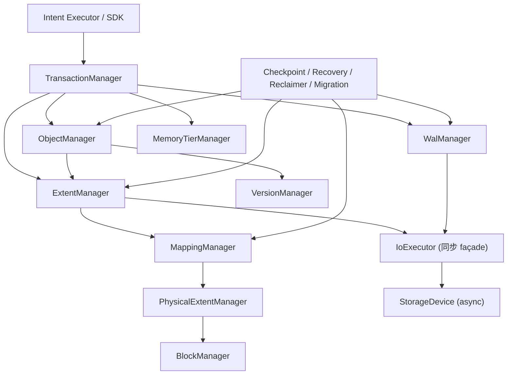

# AINS 内核接口冻结 —— Rust trait、错误类型与模块调用链

> 本文承接 [02-kernel.md](02-kernel.md) 与 [03-consistency-kernel.md](03-consistency-kernel.md)：
> 前两篇确定了「数据怎么组织」「一致性怎么保证」，本文把这两篇的结论落成**可以直接开写代码的接口契约**：
> 模块边界、trait 形状、错误类型、调用方向、锁顺序，以及「接口一旦冻结，什么情况下才能改」。
>
> 状态：设计阶段 · 接口冻结草案 v1 · 变更需走 [ADR](../adr/0008-kernel-interface-freeze.md)

## 一、本文要冻结什么

### 1.1 为什么需要接口冻结

内核是整个系统里唯一「错了就丢数据」的部分。上层 Intent 执行器、索引网格、Agent 运行时都可以演进，唯独内核的接口一旦被依赖，就不能再随手改：

- 改一个 trait 的返回类型，会同时改动 Object Manager、Extent Manager、WAL Manager、Recovery 与测试夹具；
- 改一个错误的语义，会同时改变客户端的重试策略和运维告警的分类；
- 改一个锁的持有范围，会同时改变读延迟和死锁风险。

因此本文只冻结**契约**，不冻结**实现**。

### 1.2 冻结清单

| 编号 | 契约对象 | 所属模块 | 冻结内容 | 变更方式 |
|---|---|---|---|---|
| F1 | 类型标识符 | 全局 | `ObjectId` / `VersionId` / `TransactionId` / `Lsn` / `ExtentId` / `MappingId` / `PhysicalExtentId` / `SnapshotId` 的语义与作用域 | ADR |
| F2 | 错误模型 | 全局 | `KernelError` 的变体、分类、可重试性、错误映射规则 | ADR |
| F3 | `ObjectManager` | 对象层 | 对象与版本的读写、发布、删除的入口形状 | ADR |
| F4 | `ExtentManager` | 逻辑层 | 逻辑 extent 的切分、分配、释放 | ADR |
| F5 | `MappingManager` / `PhysicalExtentManager` | 映射层 | 逻辑→物理映射的解析、切换、版本语义；物理空间的分配与回收 | ADR |
| F6 | `StorageDevice` / `IoExecutor` | 硬件层 | 设备读写、flush、耐久等级、故障上报；同步 façade 与 async HAL 的边界 | ADR |
| F7 | `WalManager` | 日志层 | 追加、flush、水位、扫描 | ADR |
| F8 | `TransactionManager` | 事务层 | 事务生命周期、快照、可见性、冲突处理 | ADR |
| F9 | `CheckpointManager` / `RecoveryManager` | 恢复层 | 检查点发布与崩溃恢复的入口 | ADR |
| F10 | `Reclaimer` | 回收层 | 六条件判定与空间回收 | ADR |
| F11 | `MigrationManager` | 迁移层 | 迁移计划、执行、状态查询 | ADR |
| F12 | `MemoryTierManager` | 资源层 | 内存/设备空间分配与释放 | ADR |
| F13 | 模块调用方向 | 全局 | 允许的依赖边、禁止的反向依赖、锁顺序 | ADR |
| F14 | 公共 API 表面 | 全局 | 公共类型只能暴露逻辑标识符，禁止暴露物理地址 | ADR |
| F15 | `Clock` | 全局 | 内核读取时间的唯一入口：生产实现读真实时钟，测试实现读假时钟；内核代码不得直接调用 `Instant::now` / `SystemTime::now` | ADR |

### 1.3 明确不冻结的内容

以下内容由实现自由决定，本文不约束：

- 具体的数据结构布局（`Vec` 还是 `SmallVec`，锁用 `parking_lot` 还是自旋锁）；
- 线程模型细节（工作线程数量、NUMA 亲和如何设置）；
- 缓存与淘汰算法的具体实现；
- 序列化格式的字段顺序（只要与 [03 §2.2](03-consistency-kernel.md) 的帧格式兼容）；
- 性能参数（批量大小、队列深度、阈值）。

**判断标准**：如果一个改动只影响「怎么实现」，不冻结；如果影响「谁必须调用谁、失败时返回什么、调用方该怎么处理」，就冻结。

## 二、通用类型与错误模型

### 2.1 标识符类型

```rust
/// 逻辑对象标识：16 字节定长不可变值，内部编码 (database_id, sequence)
pub struct ObjectId([u8; 16]);
impl ObjectId {
    pub fn database_id(&self) -> u32;
    pub fn sequence(&self) -> u64;
}

pub struct VersionId(pub u64);        // 仅在 ObjectId 作用域内单调
pub struct TransactionId(pub u64);   // 全局 xid
pub struct Lsn(pub u64);             // WAL 逻辑字节偏移
pub struct ExtentId(pub u64);        // 逻辑 extent
pub struct PhysicalExtentId(pub u64);
pub struct MappingId(pub u64);
pub struct MappingVersion(pub u64);  // 单个 Extent 内部的映射代次
pub struct SnapshotId(pub u64);
pub struct ComponentId(pub u32);
```

命名对照（本文与既有文档的等价关系，避免同一概念出现两个名字）：

| 本文 | [02-kernel](02-kernel.md) | [03-consistency-kernel](03-consistency-kernel.md) |
|---|---|---|
| `ExtentId` | `ExtentId` | `LogicalExtentId` |
| `TransactionId` | `TransactionId` / `xid` | `TxnId (xid)` |
| `ObjectId` | `ObjectId` | `ObjectId`（WAL body 中按 `[u8;16]` 落盘） |
| `ResourceType` | `ResourceType` / `ResourceId` | — |

`ObjectId` 按 16 字节定长序列化，与 [03 §2.3](03-consistency-kernel.md) 的 WAL body 字段宽度一致；`database_id` 与 `sequence` 是它的逻辑视图，不是它的存储布局。

六条硬性规则（与 [03 §1.1 R1/R2](03-consistency-kernel.md)、[03 §1.2](03-consistency-kernel.md) 一致）：

```
F1.1  ObjectId 全局稳定，永不复用。
F1.2  VersionId 只在 ObjectId 作用域内单调，禁止跨对象比较。
F1.3  Lsn 只描述 WAL 写入先后，不描述提交顺序。
F1.4  MappingVersion 只在 ExtentId 作用域内单调。
F1.5  TransactionId 单调递增分配，回收的 xid 槽位不得再被使用。
F1.6  任何持久化结构只能存逻辑标识符，禁止存裸 LBA / 裸虚拟地址。
```

`VersionId`、`Lsn`、`MappingVersion` 都是 `u64` 新类型，Rust 允许直接比较，因此要靠接口约束而不是类型系统来防止误用：

- `VersionId` 的顺序**只在同一 `ObjectId` 内**有意义。需要对象内顺序时必须调用持有作用域的接口，由它确认两者属于同一对象后再比较：

  ```rust
  // ObjectManager 提供
  fn compare_versions(&self, id: ObjectId, a: VersionId, b: VersionId) -> core::cmp::Ordering;
  ```

- `Lsn` 全局可比（它是日志偏移），但**不得**用它推断提交顺序或可见性（见 §8 T1）。
- `MappingVersion` 只在同一个 `ExtentId` 内可比。

可见性判定不通过比较任何版本号完成，只能走 §8 的 `TransactionManager::visible`。

### 2.2 顶层错误类型

```rust
#[non_exhaustive]
pub enum KernelError {
    /// 逻辑对象/版本/extent 不存在
    NotFound { kind: IdKind, id: String },

    /// 对象已存在且不允许覆盖（COW 语义下的重复创建）
    AlreadyExists { kind: IdKind, id: String },

    /// 与其他事务的写冲突：调用方需要决定是否重试
    Conflict(ConflictKind),

    /// 瞬时故障：调用方可按退避策略重试
    Retryable(RetryReason),

    /// 数据损坏：不允许静默继续
    Corrupted(CorruptionKind),

    /// 资源不足（容量、内存域、句柄）
    ResourceExhausted { resource: ResourceType },

    /// 第一版不支持的能力
    Unsupported { feature: &'static str },

    /// 设备 I/O 失败
    Io { op: IoOp, source: std::io::Error },

    /// 不变量被破坏：属于内核 bug
    Internal { code: InternalCode, detail: String },
}

pub type KernelResult<T> = Result<T, KernelError>;
```

错误载荷类型（与 `KernelError` 一同冻结）：

```rust
/// 被查找对象的类别
pub enum IdKind { Object, Version, Extent, Mapping, Component, Index, Checkpoint }

/// 冲突类别
pub enum ConflictKind {
    /// 与并发写事务冲突（Wait-Die 的 Die 分支）
    WriteConflict { object: ObjectId, expected: VersionId, actual: VersionId },
    /// 映射代次已被他人切换（迁移放弃的唯一原因）
    MappingChanged { extent: ExtentId, expected: MappingVersion, actual: MappingVersion },
    /// 语义幂等冲突：同一 fingerprint 对应不同内容
    IntentConflict { object: ObjectId },
}

/// 可重试原因
pub enum RetryReason {
    /// 设备忙（队列满、独占）
    DeviceBusy,
    /// 背压
    Backpressure,
    /// 长事务撑爆 xid 环形窗口
    ResourceBusy,
}

/// 损坏类别
pub enum CorruptionKind {
    WalRecordCrc,
    CheckpointManifest,
    ChecksumMismatch,
    VersionChainBroken,
    DirectoryDangling,
}

/// 资源类别（与 02-kernel §3.6 的 ResourceType 对应）
pub enum ResourceType { Dram, Cxl, GpuHbm, Nvme, Hdd, Internal }

/// 内部错误码：出现即内核 bug
pub enum InternalCode {
    InvariantViolation,
    StateMachineViolation,
    Unreachable,
}

/// I/O 操作类别（故障注入按此定位）
pub enum IoOp { Read, Write, Flush, Fsync, Rename, Allocate, Discard }
```

`#[non_exhaustive]` 是有意为之：它允许后续版本新增变体而不破坏调用方的 `match`（调用方必须带 `_ =>` 分支），代价是调用方不能穷尽匹配——这正是我们要的，因为错误分类需要随实现演进。

### 2.3 错误分类与调用方动作

| 变体 | 类别 | 语义 | 调用方应当做什么 | 调用方可否重试 |
|---|---|---|---|---|
| `NotFound` | 永久失败 | 逻辑对象不存在 | 视业务语义决定；读路径返回 404 | 否 |
| `AlreadyExists` | 需上层决策 | 重复创建 | 合并或改名 | 否 |
| `Conflict` | 需上层决策 | 与已提交/并发事务冲突 | **由上层决定**：重试整个工作流，或显式暴露冲突 | 否 |
| `Retryable` | 可自动重试 | 瞬时故障（忙 / 背压 / 窗口耗尽） | 指数退避重试，次数上限由 SDK 层控制 | 是 |
| `Corrupted` | 永久失败 | 校验和不匹配、链断裂 | 不得继续；触发恢复流程并告警 | 否 |
| `ResourceExhausted` | 需上层决策 | 容量/内存不足 | 触发回收或扩容后重试 | 视情况 |
| `Unsupported` | 永久失败 | 第一版不实现 | 走降级路径 | 否 |
| `Io` | 可自动重试（部分） | 设备错误 | 按 `op` 判断是否可重试 | 视 `op` |
| `Internal` | 内部 bug | 不变量被破坏 | 不应出现；出现即 bug | 否 |

「类别」列对应 [ADR-0008](../adr/0008-kernel-interface-freeze.md) 的四分类：**可自动重试 / 需上层决策 / 永久失败 / 内部 bug**。「调用方可否重试」描述的是**上层**的行为；内核自身在任何情况下都不自动重试（见 C1）。

三条关键约定：

**C1：内核内部不自动重试任何错误。** 写冲突 `Conflict` 必须原样返回给上层。如果内核悄悄重试，AI 工作流层就无法知道「这次写入失败过」，也无法决定是重试、换路径还是交给用户。自动重试只允许发生在上层，并且只针对 `Retryable` 与部分 `Io`。

**C2：`Io` 必须携带 `op`。** `IoOp` 至少包含 `Read` / `Write` / `Flush` / `Fsync` / `Rename` / `Allocate` / `Discard`，因为故障注入测试要按「第 N 次 flush 后 kill」来定位（[03 §11.3](03-consistency-kernel.md)）。

**C3：错误里禁止出现物理地址。** `KernelError` 的任何字段都不得携带 LBA、虚拟地址或设备偏移——故障诊断需要物理位置时，由调用方用自己的 `MappingId` 再查一次映射表。

**C4：`Internal` 在模块层产生，在公共 API 边界转成 panic / abort。** §2.4 允许各模块把 `Internal` 列为本模块产生的错误——这是说模块**检测到**不变量被破坏时用它携带诊断信息。但 `Internal` 不得作为普通返回值交给上层：公共 API 边界（SDK / CLI 入口）必须把 `Internal` 转成 panic 或 abort 并保留现场。否则「内核 bug」会退化成「调用方收到一个看起来像普通错误的返回值」，被上层重试或忽略。故：模块内可 `return Err(Internal{..})`，边界必须 `panic!` / `abort`，两者不矛盾。

### 2.4 错误映射规则

每个模块**自己产生**的错误限于与自身职责相关的子集；下层产生的错误允许**原样上抛**，不得在中间层改写语义：

| 模块 | 本模块产生的错误 | 允许原样上抛的错误 |
|---|---|---|
| `ObjectManager` | `NotFound` / `AlreadyExists` / `Conflict` / `Unsupported` / `Internal` | `Io` / `Corrupted` |
| `ExtentManager` | `NotFound` / `ResourceExhausted` / `Unsupported` / `Internal` | `Io` / `Corrupted` |
| `MappingManager` | `NotFound` / `Conflict(MappingChanged)` / `Internal` | `Io` |
| `WalManager` | `Io` / `Corrupted` / `ResourceExhausted` / `Internal` | — |
| `TransactionManager` | `Conflict` / `Retryable` / `Internal` | `Io` / `Corrupted` |
| `StorageDevice` | `Io` / `Unsupported` / `Internal` | — |
| `CheckpointManager` | `Io` / `Corrupted` / `ResourceExhausted` / `Internal` | — |
| `Reclaimer` | `Conflict` / `Internal` | `Io` |
| `MigrationManager` | `Conflict` / `Unsupported` / `Internal` | `Io` |
| `MemoryTierManager` | `ResourceExhausted` / `Unsupported` / `Internal` | `Io` |
| `IoExecutor` | `Io` / `Internal` | — |
| `VersionManager`（内部） | `NotFound` / `Internal` | — |

「设备错误由 `StorageDevice` 包装后上传」的具体含义：设备层把 I/O 失败转成 `KernelError::Io{op}` 或触发设备降级（`DurabilityLevel` 下降、设备被标记故障），中间层**原样上抛**，由上层决定是重试、降级还是返回错误。对象层永远看不到裸 `io::Error`，但能看到 `KernelError::Io`。

一个必须说清的例外：`TransactionManager::commit` 的 WAL flush 失败会以 `Io` 形式上抛，**不允许**被改写成 `Retryable`——上层必须能区分「盘掉了」和「暂时挤」。`Retryable` 只表示资源级瞬时（忙、背压、窗口耗尽）。

### 2.5 核心内核同步，设备 HAL 是唯一的 async 边界

内核的**核心模块**（Object / Extent / Mapping / Transaction / WAL / Checkpoint / Reclaimer / Migration / MemoryTier）全部是**同步**的：

```rust
pub trait ObjectManager: Send + Sync { /* 全部同步方法 */ }
```

理由：

- 内核的临界区短、调用链深（Object → Extent → Mapping → Device），异步化会让锁语义与可读性同时恶化；
- WAL 的 durability 语义建立在「调用返回即已持久」的同步契约上，async 会把这个契约变成「await 之后才持久」，更难证明；
- 真正需要异步的是设备 I/O 与上层（Agent 任务、网络服务）。

但**设备 HAL 是例外**：[01-overview §15.3](01-overview.md) 已经确定 `StorageDevice` 是 async 的（io_uring / SPDK 天生是完成通知模型），HAL 的后端选型由 [ADR-0004](../adr/0004-bypass-kernel-io.md) 决定。因此冻结为：

| 层 | async？ | 说明 |
|---|---|---|
| 上层（Agent / SDK / 网络服务） | 是 | 任务级并发 |
| 核心内核模块 | **否** | 本文 §3–§11 的全部 trait |
| 设备 HAL（`StorageDevice`） | **是** | io_uring / SPDK 后端 |
| 桥接层（`IoExecutor`） | 同步 façade | 核心内核唯一接触 async 的地方 |

`IoExecutor` 的职责：把设备操作提交给常驻的 I/O reactor 线程（每 NUMA 节点一个），并在完成事件上阻塞调用方，使核心内核保持「调用返回即已完成」的同步语义。

因此：**除 `StorageDevice` 与设备后端内部外，任何 trait 都不允许出现 `async fn`**。上层若需要并发访问，通过「每个连接/每个任务一个内核句柄」实现。

### 2.6 时间源 `Clock`

内核读时间的唯一入口。生产实现读真实时钟，测试实现读假时钟（[05 §4.1](05-kernel-test-harness.md)）。

```rust
/// 内核读时间的唯一入口（crate 内部，对外封闭）
pub trait Clock: Send + Sync {
    /// 单调递增的纳秒计数，起点是内核初始化时刻
    fn monotonic_nanos(&self) -> u64;
}
```

**C5：内核代码不得直接调用 `Instant::now()` / `SystemTime::now()`。** 所有与时间相关的逻辑（GC 老化、快照过期、长事务超时、保留策略、检查点周期）必须经由注入的 `Clock`。这条约束由 lint 强制（[05 §8](05-kernel-test-harness.md)）。

**C5.1：`Clock` 返回相对单调纳秒而不是 `Instant`。** `Instant` 无法在稳定版 Rust 上任意构造，假时钟实现不了「推进到任意时刻」。返回 `u64` 纳秒后，假时钟只需维护一个计数器。

**C5.2：墙上时间与单调时间分开。** 需要墙上时间（如对象创建时间戳）的场景由上层在写入时提供时间戳，内核不读墙上时钟——内核里的墙上时间会带来跨机器与跨重启的不一致。

## 三、Object Manager 与 Version Manager

### 3.1 职责边界

沿用 [02-kernel §9.1](02-kernel.md) 的划分，并补充契约：

| 模块 | 负责 | 不负责 | 本文的 trait |
|---|---|---|---|
| Object Manager | 对象创建、读取、更新入口 | 硬件分配、设备 I/O | `ObjectManager` |
| Version Manager | 版本链、版本状态 | 数据 I/O、extent 切分、可见性判定 | （内部）`VersionManager` |

两者在实现上可以是同一个结构体，但**接口上必须分开**：写路径只能经 `ObjectManager` 进入，版本链的遍历与版本状态维护只能在 `VersionManager` 内部发生。

**「版本可见性判定」归 §8 的 `TransactionManager::visible`，不归 Version Manager。** 理由是判定依赖事务状态数组（`xid → Running/Committed/Aborted`），把它放在事务管理器里才能保证判定与状态来源同源——这正是 [02-kernel §4.4](02-kernel.md) 把 Version Visibility Manager 放在 Transaction Manager 下面的原因。仓库里两种归属都出现过，这里冻结为前者。

### 3.2 `ObjectManager`

```rust
pub trait ObjectManager: Send + Sync {
    /// 创建对象（幂等键由上层负责，此处不做语义去重）
    fn create_object(&self, txn: &mut TxnCtx, req: &CreateObjectRequest) -> KernelResult<ObjectId>;

    /// 读取对象头（不含 payload）
    fn get_header(&self, id: ObjectId) -> KernelResult<ObjectHeader>;

    /// 在快照下解析可见版本；不可见时返回 NotFound
    fn resolve_version(&self, id: ObjectId, snap: &Snapshot) -> KernelResult<VersionId>;

    /// 读取指定版本的元数据视图（payload 按需通过 ExtentManager 读取）
    fn read_version(&self, id: ObjectId, ver: VersionId) -> KernelResult<ObjectView>;

    /// 在事务上下文中生成新版本（未提交前不可见）
    fn stage_version(&self, txn: &mut TxnCtx, id: ObjectId, spec: &VersionSpec)
        -> KernelResult<VersionId>;

    /// 标记对象删除（设置 xmax，不做物理删除）
    fn delete_object(&self, txn: &mut TxnCtx, id: ObjectId) -> KernelResult<()>;
}
```

三条语义约束：

**O1：`stage_version` 不产生任何对外可见性。** 新版本在事务提交前处于 `VersionState::Pending`，任何其他事务的 `resolve_version` 都看不到它。

**O2：版本发布与事务提交是同一个原子点。** 提交成功的定义是：WAL 提交记录已持久 + 内存状态已切换。二者顺序固定为「先持久后发布」（[03 §2.4](03-consistency-kernel.md) 的写入顺序），不允许反过来。

**O3：`stage_version` 只能通过 COW 产生新 extent。** 已发布的 extent 内容不可原地修改；未修改的 extent 在新版本中共享（[02-kernel §4.5](02-kernel.md)）。

### 3.3 事务上下文

```rust
pub struct TxnCtx {
    pub xid: TransactionId,
    pub state: TransactionState,   // Running / Committed / Aborted
    pub snapshot: Snapshot,
    pub read_set: ReadSet,         // 本事务读过的版本
    pub write_set: WriteSet,       // 待提交的写入
    pub start_lsn: Lsn,
    pub commit_lsn: Option<Lsn>,   // commit 时填入
}

/// 待提交写入：三类分开，因为它们对应三类不同的 WAL 记录
pub struct WriteSet {
    /// → WAL ObjectVersion
    pub version_writes: Vec<(ObjectId, VersionId)>,
    /// → WAL ExtentAlloc
    pub extent_allocs: Vec<ExtentId>,
    /// → WAL MappingCreate / MappingSwitch
    pub mapping_changes: Vec<(ExtentId, MappingId)>,
}
```

三个字段的用途不能省：

- `read_set`：① 写写冲突检测；② GC 判定时确认读者引用（[03 §8](03-consistency-kernel.md) 条件 2/3）；
- `extent_allocs` / `mapping_changes`：它们是 WAL 的 `ExtentAlloc` / `MappingCreate` / `MappingSwitch` 记录的直接来源，也是恢复时「未提交事务的待回收集合」的来源（[03 §6.3](03-consistency-kernel.md)）；
- `commit_lsn`：提交屏障的锚点，也是 `CommitReceipt` 的内容。

[02-kernel §4.4](02-kernel.md) 的 `StorageTransaction` 已经包含 `read_set` 与 `commit_lsn`，这里只是把它们显式化并补上 `WriteSet` 的内部结构。

`TxnCtx` 是内核内部唯一允许跨模块传递的可变状态载体。它的作用是把「这次写入属于哪个事务」这件事显式化，避免各模块各自维护事务上下文导致的不一致。

## 四、Extent Manager

### 4.1 职责

| 模块 | 负责 | 不负责 |
|---|---|---|
| Extent Manager | 逻辑数据切分、逻辑 extent 元数据 | 设备选择、物理分配 |
| Physical Extent Manager | 物理空间分配 | AI 语义理解 |
| Block Manager | 硬件块定位与分配 | 事务可见性 |

### 4.2 `ExtentManager`

```rust
pub trait ExtentManager: Send + Sync {
    /// 按数据类型把组件切分成逻辑 extent
    fn split(&self, id: ObjectId, comp: ComponentId, layout: LayoutType)
        -> KernelResult<Vec<ExtentId>>;

    /// 为写入准备新的逻辑 extent（内容由调用方随后写入）
    fn allocate_logical(&self, txn: &mut TxnCtx, spec: &ExtentSpec)
        -> KernelResult<ExtentId>;

    /// 把 extent 的内容写入设备并达到要求的耐久等级
    fn write_payload(&self, ext: ExtentId, data: &PayloadRef, dur: DurabilityLevel)
        -> KernelResult<()>;

    /// 读取 extent 内容
    fn read_payload(&self, ext: ExtentId, range: Range<u64>) -> KernelResult<PayloadRef>;

    /// 释放逻辑 extent（仅在 GC 判定通过后调用）
    fn release(&self, ext: ExtentId) -> KernelResult<()>;
}
```

**E1：Extent 的写入与事务提交分离。** `write_payload` 只把数据落到设备，不产生版本，也不受事务可见性影响；事务性由 `TxnCtx` 中的 WAL 记录与版本发布保证。是否 flush 由 `dur` 决定，三档对应 [§6.1 D2](#61-storagedevice) 的 `DurabilityLevel`：

| `dur` | 设备侧动作 | 掉电后果 |
|---|---|---|
| `Durable` | 执行 **data barrier**，落持久介质 | 保留 |
| `Write` | 下发到设备易失缓存，不落盘 | **丢失**（掉电可能丢） |
| `None` | 不 flush，数据只在主机侧缓冲 | 丢失 |

**E1.1：data barrier 与 WAL barrier 不可合并。** 前者在 `write_payload` 内部完成，后者在 `TransactionManager::commit` 的 `flush_upto(commit_lsn)` 完成；两者的先后顺序固定为「data barrier → WAL 记录 → WAL barrier」（[03 §2.4](03-consistency-kernel.md)）。

**E1.2：`LayoutType` 的取值见 [02-kernel §2.3](02-kernel.md)**（Fixed / Variable / Tensor Tile / Graph Partition / Append / Media Chunk 六种），第一版不再扩充。

**E2：物理释放路径与普通接口分离。** Rust 中 trait 方法的可见性跟随 trait，不能把 `pub trait` 的某个方法单独降级为 `pub(crate)`。因此释放能力拆到 crate-private 的独立 trait：

```rust
/// 仅 crate 内可见：逻辑 extent 的物理释放
pub(crate) trait ExtentReleaser: Send + Sync {
    fn release(&self, ext: ExtentId) -> KernelResult<()>;
}
```

`ExtentManager` 只对 crate 内实现它，对外不导出；调用方只能是 `Reclaimer`，且必须先通过 [03 §8](03-consistency-kernel.md) 的六条件判定。

**E3：`read_payload` 不返回原始指针。** 返回的是逻辑引用（`PayloadRef`），真实位置由 `MappingManager` 解析后交给设备层，避免物理地址泄漏到上层（对应 F14）。

## 五、Mapping Manager

### 5.1 职责

| 模块 | 负责 | 不负责 |
|---|---|---|
| Mapping Manager | 逻辑→物理映射、映射代次、原子切换 | 迁移决策（属于 Placement / Migration） |

### 5.2 `MappingManager`

```rust
pub trait MappingManager: Send + Sync {
    /// 在给定映射版本下解析物理位置（调用方必须固定版本）
    fn resolve(&self, ext: ExtentId, mv: MappingVersion) -> KernelResult<PhysicalLocation>;

    /// 创建新映射（分配阶段，尚未生效）
    fn create_mapping(&self, txn: &mut TxnCtx, ext: ExtentId, pe: PhysicalExtentId)
        -> KernelResult<MappingId>;

    /// 原子切换映射：这是迁移的唯一提交点
    fn switch_mapping(&self, txn: &mut TxnCtx, ext: ExtentId,
                      expected: MappingVersion, new: MappingId)
        -> KernelResult<MappingVersion>;

    /// 读取当前映射版本（O(1)，读路径热点的第一跳）
    fn current_version(&self, ext: ExtentId) -> KernelResult<MappingVersion>;
}
```

**M1：`resolve` 必须带显式 `MappingVersion`。** 不提供「按当前版本解析」的简化接口——正是这个简化会导致读取过程中物理位置突变（[02-kernel §2.4](02-kernel.md)）。读路径的固定写法是：

```rust
let mv = mapping.current_version(ext)?;      // 取一次
let loc = mapping.resolve(ext, mv)?;         // 用这个版本读完全程
```

**M1.1：「按版本解析」与「按 MappingId 解析」是同一件事。** `MappingVersion` 是映射的代次计数，读者取一次 `current_version` 再 `resolve`，等价于 [03 §3.1](03-consistency-kernel.md) 描述的「取 MappingId 后按 MappingId 找物理位置」。冻结为前者，是因为它让「读全程不发生物理切换」这件事直接体现在签名上；`MappingId` 仍然是 WAL 记录（`MappingCreate` / `MappingSwitch`）里的引用单位。

**M2：`switch_mapping` 的 `expected` 是乐观并发检查点。** 若当前版本已不是 `expected`，返回 `Conflict(MappingChanged)`，调用方必须放弃本次迁移（[03 §7.2](03-consistency-kernel.md)）。

**M3：映射切换先于内存发布。** `switch_mapping` 内部顺序固定为：写 `MappingSwitch` WAL 记录 → flush → 更新内存映射表 → 旧版本进入 `Draining`。

### 5.3 `PhysicalExtentManager`

| 模块 | 负责 | 不负责 |
|---|---|---|
| Physical Extent Manager | 物理空间分配与回收（设备空闲空间管理） | 逻辑切分、映射代次 |

```rust
pub trait PhysicalExtentManager: Send + Sync {
    /// 在设备上分配一段物理空间
    fn allocate(&self, txn: &mut TxnCtx, req: &PhysicalAllocRequest)
        -> KernelResult<PhysicalExtentId>;

    /// 释放物理空间（仅在 GC 判定通过后调用）
    fn release(&self, pe: PhysicalExtentId) -> KernelResult<()>;

    /// 查询设备空闲空间（水位）
    fn free_space(&self, device: DeviceId) -> KernelResult<u64>;
}
```

**P1：分配是事务性的。** 分配的物理 extent 必须进入 `TxnCtx::write_set.extent_allocs`，否则恢复时无法把它判定为「未提交事务的待回收 extent」（[03 §6.3](03-consistency-kernel.md)）。

**P2：物理释放与逻辑释放是两步。** 逻辑引用先注销（[03 §8](03-consistency-kernel.md) 的顺序要求），物理空间再归还设备（这里），顺序由 `Reclaimer` 保证，不可颠倒。

## 六、设备层

### 6.1 `StorageDevice`

本 trait **取代** [01-overview §15.3](01-overview.md) 的草案签名。相对草案有三处变化：寻址从 `ExtentId + offset + length` 改为 `PhysicalLocation`（设备层不该看到逻辑标识符）、缓冲区从 `Buffer` 改为借用（所有权由调用方决定）、`flush` 增加显式耐久等级。此外补上草案里缺失的 `discard`——物理空间真正归还设备（TRIM / deallocate）必须走这条路径，否则 §10 的回收只释放了逻辑引用，设备空间不会归还。

```rust
pub trait StorageDevice: Send + Sync {
    /// 设备标识与能力
    fn descriptor(&self) -> &DeviceDescriptor;

    /// 顺序写一段数据（不保证持久）
    async fn write(&self, loc: &PhysicalLocation, buf: &[u8]) -> KernelResult<()>;

    /// 读取一段数据
    async fn read(&self, loc: &PhysicalLocation, buf: &mut [u8]) -> KernelResult<()>;

    /// 刷盘到指定耐久等级
    async fn flush(&self, loc: &PhysicalLocation, level: DurabilityLevel) -> KernelResult<()>;

    /// 归还设备空间（TRIM / deallocate）；不可用时返回 Unsupported
    async fn discard(&self, loc: &PhysicalLocation) -> KernelResult<()>;

    /// 当前可达的最高耐久等级（设备降级后下降）
    fn max_durability(&self) -> DurabilityLevel;

    /// 报告设备健康状态（后台采集，也可被查询）
    fn health(&self) -> DeviceHealth;
}
```

**D0：本 trait 是内核里唯一允许 `async fn` 的 trait**，实现的是 [ADR-0004](../adr/0004-bypass-kernel-io.md) 选定的 Storage HAL。后端实现优先级（io_uring → SPDK → `preadv2` 回退）与能力探测见 [architecture/04 §2](../architecture/04-hardware-path.md)，回退矩阵见 [architecture/04 §8](../architecture/04-hardware-path.md)。所有后端必须通过同一套语义测试。

**D0.1：dyn 兼容性用 `async_trait` 保证。** 原生 `async fn` 定义的 trait 不是 dyn 兼容的，而 `IoExecutor` 必须能同时持有 io_uring / SPDK / POSIX / CXL / GPU / Remote 多种后端。第一版用 `#[async_trait]`（boxed future）保证 `Box<dyn StorageDevice>` 可用；后续若要消除这一次装箱，改用 RPITIT + 泛型静态分发（`IoExecutor<Backend>`），接口形状不变。这是 [01-overview §15](01-overview.md) 提出的「对象安全性、异步 I/O 生命周期」待定项的答案。

**D0.2：`StorageDevice` 不使用 `private::Sealed`。** 它必须允许 crate 外部实现后端；其余内核 trait 全部封闭（见 §14.1 规则 3）。

**D1：设备层不感知事务。** `StorageDevice` 的签名里没有 `xid`、没有 `lsn`、没有 `snapshot`。事务语义完全由上层的 WAL + 版本机制提供。

**D2：耐久等级是显式参数，不是隐含行为。** 第一版只有三个取值：

```rust
pub enum DurabilityLevel {
    /// 仅在内存 / 易失设备上，不保证任何持久
    None,
    /// 已下发到设备缓存，掉电可能丢失
    Write,
    /// 已落到持久介质，掉电不丢
    Durable,
}
```

`write` 本身**不带**任何隐式持久化保证；是否 flush 由调用方显式指定（见 E1）。

**D3：设备降级必须可见。** 设备故障或降级后 `max_durability()` 必须下降，且 `health()` 必须报告 `Degraded`/`Failed`。上层据此决定是否把数据复制到别处。

### 6.2 `MemoryTierManager`

```rust
pub trait MemoryTierManager: Send + Sync {
    /// 在指定资源域分配空间
    fn allocate(&self, req: &MemoryAllocationRequest) -> KernelResult<MemoryAllocation>;

    /// 释放空间
    fn free(&self, alloc: AllocationId) -> KernelResult<()>;

    /// 查询资源域状态（容量、压力、故障）
    fn stats(&self, resource: ResourceId) -> KernelResult<ResourceStats>;
}
```

统一的是**管理接口与资源生命周期**，不是底层分配算法：DRAM 用 NUMA-aware 分配器，GPU 用 CUDA/HIP 分配器，NVMe 用 extent 分配器，CXL 用其设备管理接口（[02-kernel §3.6](02-kernel.md)）。

### 6.3 `IoExecutor`（同步 façade）

设备 HAL 是 async 的，核心内核是同步的，桥接这两者的只有一个组件：

```rust
/// 提交给 reactor 的设备操作单位
pub enum DeviceOp {
    Write   { loc: PhysicalLocation, data: Vec<u8> },
    Read    { loc: PhysicalLocation, len: u64 },
    Flush   { loc: PhysicalLocation, level: DurabilityLevel },
    Discard { loc: PhysicalLocation },
}

/// 设备操作的结果（读取结果通过调用方提供的缓冲区回填）
pub struct DeviceResult;

pub trait IoExecutor: Send + Sync {
    /// 提交一次设备操作并等待完成（阻塞调用方）
    fn submit_and_wait(&self, op: DeviceOp) -> KernelResult<DeviceResult>;

    /// 批量提交并等待全部完成（写路径的批量化入口）
    fn submit_batch_and_wait(&self, ops: &[DeviceOp]) -> KernelResult<Vec<DeviceResult>>;
}
```

**I1：每个 NUMA 节点一个 reactor 线程。** 提交时把操作投递给该 NUMA 节点上的 reactor，由它调用 `StorageDevice` 的 async 方法；完成后唤醒阻塞中的调用方。

**I2：`submit_and_wait` 的完成语义等价于同步调用。** 调用返回时，设备操作已经完成（写已下发、flush 已落盘），错误已按 §2.3 分类。这保证核心内核的「调用返回即已持久」契约不被 async 破坏。

**I3：核心内核只通过 `IoExecutor` 触达设备。** `ExtentManager::write_payload`、`WalManager::flush_upto` 等同步方法内部使用 `IoExecutor`，不直接持有 `StorageDevice`。

**I4：reactor 不持有内核锁。** reactor 只做「提交 → 等完成 → 回调」，不触碰版本链、映射表与目录锁；回调只投递完成事件（§12.3 X1 的「禁止持锁做 I/O」在 reactor 侧同样成立）。

**I5：`IoExecutor` 持有 `Box<dyn StorageDevice>`。** 这是 D0.1 选用 `async_trait` 的直接原因：多种异构后端必须在运行时可替换。`DeviceOp` 因此是**枚举**而不是泛型——后端的差异由 `PhysicalLocation` 的变体承载，不在操作类型上分叉。

**I1.1：I1 的「该 NUMA 节点」指设备所在的节点。** 投递给哪个 reactor、I/O 缓冲区放在哪个节点、以及队列深度与 flush 槽位的硬边界，属于 [04 §1.3](#13-明确不冻结的内容) 明确不冻结的性能参数，因此不进入本文的冻结清单；它们的推导方式与硬边界见 [07-hardware-resource-management.md](07-hardware-resource-management.md) 与 [ADR-0010](../adr/0010-hardware-resource-management.md)。这里只消歧义，不冻结数值。

## 七、WAL Manager

```rust
pub trait WalManager: Send + Sync {
    /// 追加一条记录，返回其 LSN（不保证已持久）
    fn append(&self, rec: &WalRecord) -> KernelResult<Lsn>;

    /// 刷盘到目标 LSN，返回时保证 target_lsn 及之前的记录已持久
    fn flush_upto(&self, target: Lsn) -> KernelResult<()>;

    /// 当前已确认持久的水位
    fn durable_lsn(&self) -> Lsn;

    /// 从指定 LSN 开始扫描有效记录（恢复用；遇损坏即终止并返回终止 LSN）
    fn scan_from(&self, from: Lsn) -> KernelResult<WalScan>;

    /// 计算可截断边界（低于该 LSN 的段在满足条件后可删除）
    fn min_required_lsn(&self) -> Lsn;
}
```

**W1：`append` 不隐含 flush。** 提交路径显式调用 `flush_upto(commit_lsn)`；第一版每次提交单独 flush，组提交作为后续优化（[03 §2.5](03-consistency-kernel.md)）。

**W2：`scan_from` 遇到损坏必须停止而不是跳过。** 跳过会让恢复静默丢失记录；停止则尾部损坏被正确识别为「崩溃点」，这是正常情况而不是错误。

**W3：WAL 只含元数据与校验和，不含 payload。** 大 payload 不进 WAL（[02-kernel §5.3](02-kernel.md)）。记录类型的全集见 [03 §2.3](03-consistency-kernel.md)：Transaction / Object / Extent / Mapping / **Index** / **Maintenance** 六类——其中 Index 与 Maintenance（`IndexDelta`、`IndexManifest`、`MigrationBegin/End`、`CompactionBegin/End`、`CheckpointBegin`）同样必须落 WAL，否则恢复流程（[03 §6.1](03-consistency-kernel.md)）会缺少必要记录。

## 八、Transaction Manager

```rust
pub trait TransactionManager: Send + Sync {
    /// 开始事务，分配 xid 并建立快照
    fn begin(&self, mode: IsolationLevel) -> KernelResult<TxnCtx>;

    /// 提交：WAL 持久 + 内存发布
    fn commit(&self, txn: &mut TxnCtx) -> KernelResult<CommitReceipt>;

    /// 中止
    fn abort(&self, txn: &mut TxnCtx) -> KernelResult<()>;

    /// 版本可见性判定（纯函数、无 IO、无锁）
    fn visible(&self, ver: &ObjectVersion, snap: &Snapshot) -> bool;

    /// 查询事务状态（供恢复与可见性判定使用）
    fn status(&self, xid: TransactionId) -> TxnStatus;
}
```

**T1：可见性只由 xid + 事务状态决定。** 不使用 `VersionId`、`Lsn` 或时间戳近似（[03 §1.1 R3](03-consistency-kernel.md)）。`visible` 是纯函数且不取任何锁——它是读路径上唯一每版本都要执行的热点。

**T2：提交顺序固定。** `commit` 内部（与 [03 §2.4](03-consistency-kernel.md) 的六步一一对应）：

```
1. 新 extent 的 payload 写入设备                        （在 write_payload 阶段完成）
2. flush 该 extent 达到要求的耐久等级   ← data barrier
3. 写全部依赖 WAL 记录（版本 / 映射 / 分配）
4. 写 TxnCommit 记录，得到 commit_lsn
5. flush_upto(commit_lsn)                ← wal barrier
6. 发布内存版本（Pending → Published）
7. 返回 CommitReceipt
```

**T2.1：`commit` 必须校验 data barrier 已达成。** 第 1–2 步在 `stage_version` / `write_payload` 阶段完成；`commit` 开始时校验本次写入涉及的所有 extent 的 payload 已达到要求的耐久等级，未达到则中止并返回 `Io{op: Flush}`。绝不允许「先写 WAL 提交记录、再补 flush payload」——那正是 [03 §2.4](03-consistency-kernel.md) 明确禁止的假提交。

**T3：冲突用 Wait-Die，不做死锁检测。** 写冲突返回 `Conflict(ConflictKind::WriteConflict)`——这取代了 [03 §3.2](03-consistency-kernel.md) 中的 `RetryableConflict` 命名：错误分类由本文统一（[ADR-0008](../adr/0008-kernel-interface-freeze.md)）。冲突由上层决定重试；内核不自动重试（C1）。

**T4：长事务影响 `xmin` 推进。** 事务状态数组是环形复用（`xid mod RING_SIZE`），最老可复用 xid 由 `xmin` 决定；长事务撑爆窗口时返回 `Retryable(RetryReason::ResourceBusy)`，而不是放宽可见性规则。

**T5：第一版只支持快照隔离。** `IsolationLevel` 取值只有 `Snapshot`（事务级快照，[02-kernel §4.3](02-kernel.md)）；`ReadCommitted` 与 `Serializable` 留到后续 ADR。命名与 [01-overview §15.5](01-overview.md) 的 `IsolationLevel` 一致。

## 九、Checkpoint 与 Recovery

```rust
pub trait CheckpointManager: Send + Sync {
    /// 触发一次检查点（后台线程执行；本方法同步返回 checkpoint_id，不等待完成）
    fn trigger(&self) -> KernelResult<CheckpointId>;

    /// 查询当前已发布的检查点
    fn current(&self) -> KernelResult<CheckpointInfo>;

    /// 计算可删除的旧检查点 / WAL 段
    fn reclaim_candidates(&self) -> KernelResult<ReclaimPlan>;
}

pub trait RecoveryManager: Send + Sync {
    /// 启动时执行恢复，返回恢复后的内存状态
    fn recover(&self) -> KernelResult<RecoveredState>;

    /// 校验当前状态的一致性（测试与运维巡检共用）
    fn verify(&self, scope: VerifyScope) -> KernelResult<VerifyReport>;
}
```

**K1：检查点是影子文件 + 原子发布。** 三阶段算法（Capture / Snapshot&Write / Publish）见 [03 §5.2](03-consistency-kernel.md)；`CheckpointManager` 不暴露「原地修改检查点」的接口。

**K2：恢复不做用户数据 undo。** 未提交事务的数据不做回滚，靠 MVCC 可见性 + GC 清理（[03 §6.3](03-consistency-kernel.md)）。**唯一的例外是未完成的迁移**：按 [03 §6.1](03-consistency-kernel.md) step 7 回滚（丢弃目标 extent，或补记 `MigrationEnd`）——这是必要的，因为映射是否已切换决定了数据是否可见。

**K3：`verify` 是内核内唯一的校验实现，测试与运维巡检共用。** 故障注入测试不能用「人眼对比」判定正确性（[03 §11.3](03-consistency-kernel.md)）。

**K3.1：故障注入测试另有一个独立于内核的外部重建器**（[05 §5.3](05-kernel-test-harness.md)），它绕过内核 API 直接扫描底层存储。两者**不互相替代**：

| | `RecoveryManager::verify` | 外部重建器 |
|---|---|---|
| 检查什么 | 内核**自认为**的状态是否自洽（引用计数、epoch、状态机、映射合法性） | **磁盘上实际有什么**与内核的认知是否一致 |
| 能否发现「内核自己不知道自己丢了什么」 | 否 | **是** |
| 使用者 | 运维巡检、故障注入用例 | 仅故障注入测试 |

只做前者，会漏掉「内核状态自洽但与磁盘不一致」这一类缺陷；只做后者，会漏掉内核内部不变量（引用计数、epoch）被破坏但磁盘看起来正常的情况。

## 十、Reclaimer（GC）

```rust
pub trait Reclaimer: Send + Sync {
    /// 扫描候选（只读，不改变状态）
    fn scan(&self, budget: ScanBudget) -> KernelResult<Vec<ReclaimCandidate>>;

    /// 对单个对象执行六条件判定
    fn judge(&self, cand: &ReclaimCandidate) -> KernelResult<ReclaimDecision>;

    /// 执行回收：先注销引用，再释放物理空间
    fn reclaim(&self, cand: &ReclaimCandidate) -> KernelResult<()>;
}
```

**R1：判定与执行分离。** `judge` 必须是纯判定（不释放任何东西），`reclaim` 才是副作用。这样判定可以被并发地做多遍而不互相干扰。

**R2：判定必须在快照式视图上做。** 否则「判定通过」到「执行回收」之间可能加入新读者（[03 §8](03-consistency-kernel.md)）。

**R3：顺序不可颠倒。** 先注销引用，再释放物理空间；反过来会出现 use-after-free。

**R4：六个条件缺一不可。** 具体条件见 [03 §8](03-consistency-kernel.md)，代码评审中对任何一条做「等价简化」都要留下论证。

**R5：迁移相关的 extent 另需三个附加条件。** 正在 Draining 的旧映射对应的 extent，除了通过六条件判定，还必须满足 [03 §7.4](03-consistency-kernel.md) 的三个迁移附加条件（已完成 M8、已有持久化新映射、不在任何 checkpoint 的读取集合中）。`judge` 必须一并检查它们，否则会放行正在被 checkpoint 读取的 extent。

## 十一、Migration Manager

```rust
pub trait MigrationManager: Send + Sync {
    /// 制定迁移计划（放置决策的结果）
    fn plan(&self, ext: ExtentId, target: ResourceId) -> KernelResult<MigrationPlan>;

    /// 执行迁移（含映射切换提交点）
    fn execute(&self, plan: &MigrationPlan) -> KernelResult<MigrationOutcome>;

    /// 查询迁移状态
    fn status(&self, ext: ExtentId) -> KernelResult<MigrationState>;
}
```

**G1：`MappingSwitch` 是唯一提交点。** 提交点之前一切可回滚，之后一切必须完成（[03 §7.3](03-consistency-kernel.md)）。

**G2：并发写冲突时放弃迁移，不做增量同步。** 第一版不实现增量同步；热点 extent 反复失败由 Placement Manager 退避处理。

**G3：迁移是后台任务，不阻塞用户路径。** 迁移期间对象仍然可读（读旧映射），迁移失败不影响可见性。

## 十二、模块调用链与依赖方向

### 12.1 允许的调用方向



箭头 = **调用方向**（上层调下层）。[02-kernel §9.3](02-kernel.md) 的图画的是另一种东西——**组件包含关系**（Object Manager 之下挂着 Version / Extent / Transaction / WAL Manager），两者不矛盾：组件归属不等于调用方向。本文冻结的是调用方向，因此 `TxnCtx` 由上向下传递（`stage_version(txn, …)`），而不是让 Object Manager 反向持有事务管理器。

### 12.2 依赖禁令

| 禁止 | 原因 | 替代做法 |
|---|---|---|
| `StorageDevice` → 任何上层模块 | 设备层回调会形成环，且把事务语义泄漏到底层 | 设备通过 `health()` 被动上报 |
| `ExtentManager` → `ObjectManager` | 逻辑切分不应知道对象语义 | 用 `ObjectId` / `ComponentId` 参数传递 |
| `WalManager` → `ObjectManager` | 日志层不应回调对象层 | WAL Manager 只负责帧封装与持久化；记录体由上层按 [03 §2.3](03-consistency-kernel.md) 的类型构造，Manager 不解析对象语义 |
| `MappingManager` → `PlacementManager` | 映射不决定放置 | 放置结果以参数传入 |
| 任意模块 → 任意模块的内部结构体 | 破坏封装 | 只经 trait 交互 |
| 跨模块直接访问内存映射表 | 绕过映射版本，破坏 INV3 | 经 `MappingManager` |

### 12.3 锁顺序

沿用 [03 §3.1](03-consistency-kernel.md) 的五层锁，严格按 **L5 → L4 → L3 → L2 → L1** 顺序获取，禁止逆序：

| 层 | 保护对象 | 持有时间 |
|---|---|---|
| L5 系统状态 | WAL Manager / Checkpoint / GC | 毫秒级，禁止在持锁期间做 I/O |
| L4 元数据页 | Directory / FSM | 微秒级 |
| L3 映射 | Extent → Mapping | 极短，取到映射即释放 |
| L2 版本可见性 | Version Chain | 无锁（原子指针 + Epoch） |
| L1 事务锁 | ObjectId（写意向） | 事务级，仅写事务持有 |

**X1：禁止持锁做设备 I/O。** 除 L5 明确禁止外，L4/L3 同样禁止；**设备** I/O 必须在无锁状态下完成。

**X1.1：唯一的例外是 WAL 的 append + flush。** 迁移的提交点需要在 L3 写锁下写 `MappingSwitch` 并 flush，以保证「校验代次 → 写 WAL → 切换映射」是一个原子步骤，中间不会被另一个迁移插入（[03 §7.1 M6](03-consistency-kernel.md)）。这个例外只覆盖 **WAL 设备**，不覆盖 payload 的设备 I/O——payload 在迁移开始前就已落盘并 flush（[03 §7.1 M3–M5](03-consistency-kernel.md)）。

**X2：禁止持锁等待用户回调。** 同上。

## 十三、错误传播与降级

### 13.1 传播规则

| 场景 | 传播方式 |
|---|---|
| 设备 I/O 失败 | `StorageDevice` → `Io{op}` → `IoExecutor` → `ExtentManager` / `WalManager` / `TransactionManager` 原样上抛 |
| 校验和不匹配 | 设备层 → `Corrupted` → 上抛，不重试、不忽略 |
| 写冲突 | `TxnCtx` 冲突表 → `Conflict(WriteConflict)` → 上层工作流决定 |
| 映射竞态 | `switch_mapping` → `Conflict(MappingChanged)` → 迁移放弃 |
| 资源不足 | `ResourceExhausted` → 触发 GC 或扩容 |
| 设备降级 | `health()` 报告 `Degraded` → Placement 把该设备排出候选 |

### 13.2 降级路径

| 故障 | 降级行为 | 不允许的行为 |
|---|---|---|
| DRAM 不可用 | 降级到 NVMe 读，缓存禁用 | 把 DRAM 副本当唯一副本 |
| NVMe 读错误 | v1 无副本：返回 `Io{op: Read}` 并告警 | 静默返回脏数据 |
| GPU 不可用 | 任务回落到 CPU 执行 | 让 GPU 直接读 NVMe 而无缓冲管理 |
| WAL 盘不可用 | 停止写入（新事务全部失败） | 允许「未持久即返回」 |
| 检查点失败 | 保持上一个完整检查点，重试 | 删除旧检查点后再做新的 |

最后一行是硬约束：**新检查点失败时绝不能删除旧检查点**（[03 §5.1](03-consistency-kernel.md) 的失败模型）。

副本切换不在 v1 范围内：第一版是单机单副本（[03 §9.2](03-consistency-kernel.md) 的设计债务表），DRAM 在 v1 是 Cache 而不是 Replica（[02-kernel §3.7](02-kernel.md)），不能充当持久副本。多副本仲裁留到分布式 ADR。

## 十四、接口冻结的落地方式

### 14.1 编译期约束

```rust
mod private { pub trait Sealed {} }

/// 关键 trait 对外封闭：v1 期间不允许外部实现，避免语义漂移
pub trait ObjectManager: private::Sealed + Send + Sync { /* ... */ }
```

四个约束用类型系统表达，而不是靠评审：

1. **对外 API 表面不得出现物理类型。** `PhysicalLocation`、`PhysicalExtentId` 只允许出现在 crate 内部的 trait（`StorageDevice`、`MappingManager`、`PhysicalExtentManager`、`IoExecutor`）里，这些 trait 不对 SDK 与上层导出；**对外暴露的 trait 全部只接受逻辑标识符**。可以用 `cargo public-api` 快照 + lint 规则守住。
2. **错误枚举用 `#[non_exhaustive]`。** 新增变体不算破坏性变更。
3. **内核 trait 用 `private::Sealed` 封闭，`StorageDevice` 是唯一例外。** 封闭的是内核 trait（`ObjectManager` / `VersionManager` / `MappingManager` / `PhysicalExtentManager` / `IoExecutor` / `TransactionManager` / `WalManager` / `CheckpointManager` / `RecoveryManager` / `Reclaimer` / `MigrationManager` / `MemoryTierManager` / `Clock`），外部无法实现，避免「半实现的 ObjectManager」破坏不变量；`StorageDevice` 必须允许外部实现后端（见 D0.2）。
4. **关键 trait 中标记 `#[doc(hidden)]` 的内部方法不进入对外文档与 API 快照。**

### 14.2 CI 检查

| 检查 | 工具 | 失败条件 |
|---|---|---|
| 公共 API 表面变更 | `cargo public-api` diff | 快照未更新 |
| 公共类型不含物理标识符 | 自定义 lint / grep | 出现 `PhysicalLocation` 等 |
| 错误枚举变体新增 | 快照 diff | 需要同时更新 §2.3 的分类表 |
| trait 签名变更 | 快照 diff | 需要 ADR |
| 不变量断言 | 单元测试 | 任何 `INV1`–`INV5` 断言失败 |

### 14.3 变更流程

```
接口变更请求
   │
   ├─ 只改实现，不改签名            → 正常开发流程
   ├─ 改签名但不改语义（加默认方法） → 需更新本文 §2.3 / §3–§11 与快照
   └─ 改语义（错误分类、锁范围、提交顺序）
          → 必须写 ADR，并在本文标注「§X.Y（ADR-00XX）」
```

**已冻结、不得单方面变更的语义**（改动需 ADR）：

| 语义 | 出处 |
|---|---|
| 提交成功 = 依赖已持久 | [03 §1.3](03-consistency-kernel.md) |
| 设备 HAL 是内核唯一的 async 边界，核心内核同步 | 本文 §2.5；async 形态来自 [01-overview §15.3](01-overview.md)，HAL 选型来自 [ADR-0004](../adr/0004-bypass-kernel-io.md) |
| 可见性只由 xid + 事务状态决定 | [03 §1.1](03-consistency-kernel.md) |
| 物理地址永不进入逻辑身份 | [03 §1.2](03-consistency-kernel.md) |
| `MappingSwitch` 是迁移唯一提交点 | [03 §7.3](03-consistency-kernel.md) |
| GC 六条件合取且无捷径 | [03 §8](03-consistency-kernel.md) |
| 恢复不做用户数据 undo（未完成迁移按 [03 §6.1](03-consistency-kernel.md) step 7 回滚） | [03 §6.3](03-consistency-kernel.md) |
| 索引恢复与对象恢复分离 | [02-kernel §6.5](02-kernel.md) |
| Cache 与 Replica 分离 | [02-kernel §3.7](02-kernel.md) |

## 十五、冻结之后可以立刻开始写的代码

在 [02-kernel §11.1](02-kernel.md) 的路线图上，按本文的**接口依赖**细化为下表。差异说明：02-kernel 把「Object + Extent」排在第一步（先定数据模型），本文按可编译依赖排序（设备与日志在最下层），两者是同一路线的不同切面；02-kernel 第 5 步的 Memory Tier Manager 与第 6 步的 GPU HBM Backend 在此对应 §6.2 与 §6.1。

| 顺序 | 模块 | 依赖本文的契约 |
|---|---|---|
| 1 | `StorageDevice`（NVMe / DRAM / CXL / GPU / POSIX / Remote 后端，v1 先做前三类） | §6.1 |
| 2 | `IoExecutor`（同步 façade + reactor 线程） | §6.3 |
| 3 | `WalManager` | §7 |
| 4 | `MappingManager` + `PhysicalExtentManager` | §5.2、§5.3 |
| 5 | `ExtentManager` | §4 |
| 6 | `ObjectManager` + `VersionManager` | §3 |
| 7 | `TransactionManager` | §8 |
| 8 | `MemoryTierManager` | §6.2 |
| 9 | `CheckpointManager` / `RecoveryManager` | §9 |
| 10 | `Reclaimer` / `MigrationManager` | §10、§11 |

每个模块的单元测试直接用 §2.3 的错误分类做断言：每种错误路径都要有一条测试。

## 十六、下一步

本文冻结了接口，但不等于可以并行开工。还需要三件事：

1. **夹具先行**：先写一个「假设备」（文件支撑的持久介质 + 易失缓存分层 + 可注入的故障点）与「假时钟」，让前 6 个模块能在没有真实硬件时被完整测试。夹具本身要遵守 §14.1 的约束。 → 已完成，见 [05-kernel-test-harness.md](05-kernel-test-harness.md)。
2. **不变量可执行化**：把 [03 §10](03-consistency-kernel.md) 的五条不变量与 [architecture/02 §0.1](../architecture/02-storage-engine.md) 的 I1–I6 全部写成 `feature = "invariants"` 下的**常驻**检查（不是只在 CI 里跑一次）：既在每次 CI 中断言，也在长时间运行的 fuzz / soak 中持续断言。其中依赖设备行为的不变量（INV2、INV5、架构 I1/I5/I6）**额外**由每一个崩溃注入用例断言——它们既是常驻检查项，也是 L2 用例的通过条件。注意 architecture/02 的 **I2 需要修订**：旧表述「提交顺序 = 日志顺序 = 版本顺序」与 [03 §1.1 R1/R3](03-consistency-kernel.md)（LSN 不描述提交顺序、可见性不用 VersionId）冲突，应改为「提交顺序 = 日志顺序；版本顺序由 xid 决定，不由 VersionId 决定」。 → 已完成，见 [05-kernel-test-harness.md §5.4](05-kernel-test-harness.md)；architecture/02 的 I2 表述已修订。
3. **错误码到运维动作的映射表**：把 `KernelError` 的每个变体映射到「重试 / 降级 / 告警 / 人工介入」，写进 [architecture/07-operations.md](../architecture/07-operations.md)。 → 已完成，见 [architecture/07 §6.3](../architecture/07-operations.md)。

这三件事完成后，第一版内核就可以在没有真实 NVMe 与 GPU 的情况下跑通端到端的写入—崩溃—恢复闭环。

但「跑通闭环」不等于「结论可信」：假设备本身是被测模型，只用它验证自己等于没验证。**假设备与真机的对拍是发布的前置条件**，且必须区分两个失效域——进程崩溃（`kill -9`，不丢 OS page cache）与掉电（真断电，丢设备写缓存），详见 [05 §7.3](05-kernel-test-harness.md)。

夹具体系还带来两条对本文的补充约束，记在 [ADR-0009](../adr/0009-fault-injection-harness.md)：

1. **故障注入的语义 site 分两类**：**设备级** site（对应一次设备操作）由 `IoExecutor` 一层承载，保证打点顺序与真实 I/O 顺序一致；**内核级** site（不对应任何设备操作，如 GC 摘链、内存版本发布、事务提交点）在模块内显式打点，其顺序由内核逻辑顺序保证。两类不可混用同一机制——否则逻辑级 site 的「顺序与 I/O 一致」这个前提根本不存在。
2. **`Clock` 纳入冻结范围**（F15）：内核读取时间的唯一入口，测试实现读假时钟。这要求 `IoExecutor` / 各模块不再直接调用 `Instant::now()`。

